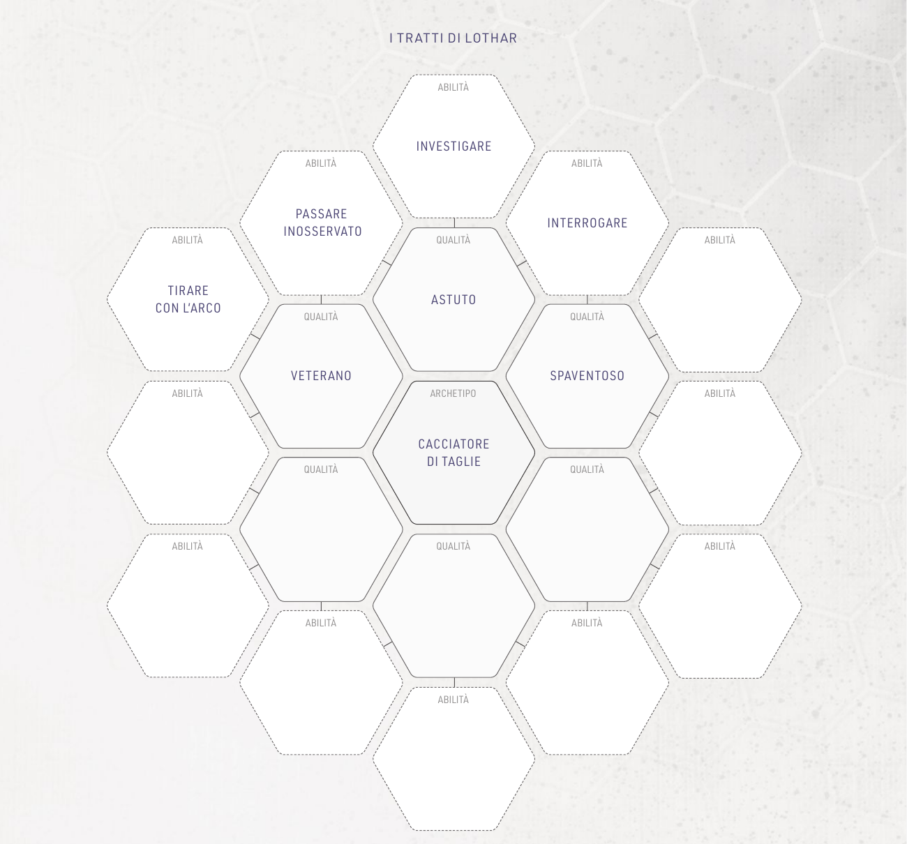
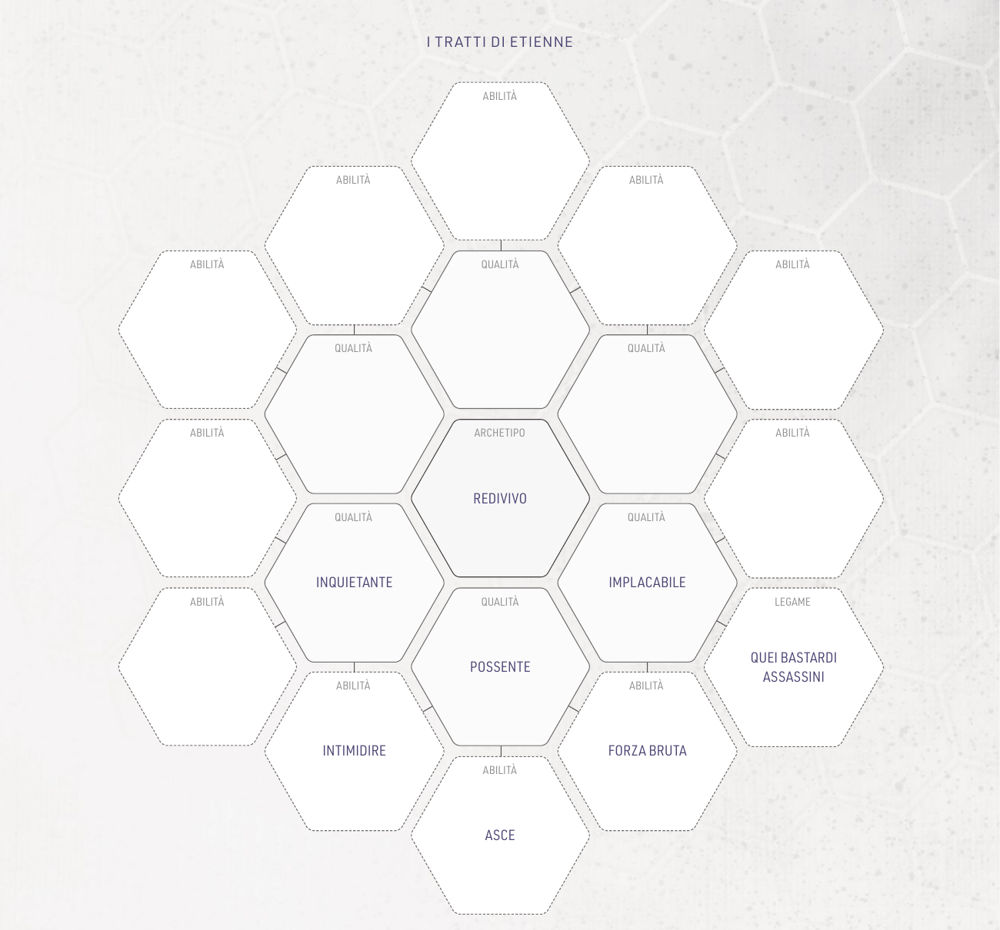

# Gli eroi di Not the End

## Creare l'eroe

Per creare un eroe di Not the End servono un po' di immaginazione e pochi minuti. Tutto ciò che ti serve è un'idea di base da arricchire seguendo un breve percorso guidato.

Se ti è possibile, crea il tuo eroe assieme agli altri giocatori e al narratore, il risultato finale sarà di gran lunga migliore.

Nelle prossime pagine esplorerai in dettaglio tutti i passi necessari a creare l'eroe e troverai spiegazioni ed esempi pratici che ti faciliteranno il percorso.

### I passi da seguire per creare un eroe

1. **Descrivi l'eroe in una frase.** Questa frase ti servirà come punto di partenza per sviluppare e dettagliare l'eroe nelle fasi successive.
2. **Elenca i suoi tratti distintivi.** I tratti sono parole chiave che lo descrivono, che vanno posizionate in un alveare di esagoni. Colloca al centro 1 tratto che definisce il suo archetipo, attorno ad esso 3 tratti che definiscono le sue qualità e nella parte esterna 4 tratti che descrivono le sue abilità.
3. **Elenca le risorse che possiede.** Con il termine risorsa si identifica tutto ciò che può essere utile all'eroe (equipaggiamento, contatti). Scrivine da 3 a 5 a tuo piacimento.
4. **Scegli il suo nome.** Dai un nome al tuo eroe e avrai concluso il percorso di creazione!

**Dove trovo la scheda dell'eroe?** Puoi scaricare la scheda dell'eroe e i materiali di gioco su https://fumblegdr.it

## Descrivi l'eroe in una frase

Il giocatore individua il fulcro dell'eroe e lo descrive in modo sintetico, in una o massimo due frasi.

> Un vigilante mascherato che vuole riportare la giustizia nel suo quartiere, un cronista di corte con il pallino per il mistero o uno schiavo liberato che ha visto l'inferno, sono tutti ottimi esempi.

Questa traccia ti farà da linea guida per le domande successive. Non serve nulla di specifico, basterà qualcosa che ti permetta di trovare a grandi linee il tuo posto all'interno dello scenario di gioco. Se lo desideri, comincia a pensare alla psicologia e ai moventi del tuo eroe. Perché il tuo eroe è come te lo immagini? Quali sono le cose per cui è disposto a rischiare? Non è necessario che tu decida adesso, ma cominciare a pensarci ti aiuterà a creare un personaggio sfaccettato.

### Ci sono limiti che devo rispettare?

> Potresti essere un animale divenuto senziente a causa di un incantesimo, un simbionte che controlla le azioni di qualcuno, uno spirito errante, un cyborg o qualsiasi cosa tu possa immaginare.

In Not the End non esiste alcun limite al tipo di eroe che puoi interpretare. La cosa importante è che l'eroe che scegli di interpretare sia adeguato al contesto di gioco che avete scelto per la vostra avventura e che possa inserirsi in modo armonico nel gruppo.

### Dove segno questa descrizione?

Non sarà necessario scrivere quanto hai deciso sulla scheda dell'eroe, questa idea iniziale ti sarà utile a rispondere alle domande successive.

Se desideri scrivere ciò per cui il tuo eroe è disposto a rischiare, abbiamo dedicato uno spazio sulla scheda dove puoi segnarlo. Ricorda che questo concetto può evolversi e cambiare liberamente nel tempo.

Il tuo eroe imparerà durante la storia ciò che considera davvero importante, e potresti stupirti nello scoprire quanto è diverso da quello che ti saresti aspettato all'inizio.

## Elenca i suoi tratti distintivi

Il giocatore descrive l'eroe scrivendone l'archetipo, 3 qualità e 4 abilità negli esagoni corrispondenti all'interno della scheda.

Not the End ti lascia libero di definire delle parole chiave che rappresentano la visione che hai del tuo eroe. Queste parole chiave si chiamano tratti, e vanno inserite in un alveare di esagoni che si trova al centro della scheda dell'eroe.

### A cosa servono i tratti?

> Essere Bellissimo non è meglio che essere Orribile: il primo tratto potrebbe essere utile per sedurre qualcuno, il secondo per intimidirlo. I tratti non compatibili con le prove che affronti non peggiorano la situazione, semplicemente non ti danno alcun vantaggio.

Quando affronti una prova, ogni tratto che metti in gioco ti permette di aggiungere 1 token di successo al sacchetto. Più tratti metti in gioco in una prova, maggiori sono le probabilità di successo. Non esistono tratti negativi in senso assoluto e in nessun caso un tratto ti obbligherà ad aggiungere 1 token di complicazione al sacchetto.

### Come definisco i tratti del mio eroe?

Per definire i tratti rispondi in ordine alle tre domande che seguono:

**Qual è l'archetipo del mio eroe?** Il giocatore scrive un tratto che identifichi l'archetipo dell'eroe nell'esagono che si trova al centro dell'alveare.

> Hacker, Samurai, Truffatore, Mercante, Elfo, Pilota, Occultista, sono tutti ottimi esempi. Puoi essere più specifico, per esempio scrivere Guerriero nanico invece di Guerriero. Un archetipo simile non entrerà in gioco se cerchi di utilizzare un arco, ma ti aiuterà durante una gara di bevute o l'esplorazione di una miniera. Parole iconiche come Eletto, Vampiro, Lupo Mannaro o Cavaliere Jedi sono ottimi esempi di archetipo, dato che l'ambientazione a cui fanno riferimento le delineano in modo chiaro.

Puoi scegliere il nome di una professione, di una razza, di una specie o un misto tra queste. Oppure puoi scegliere una parola consolidata nel canone dell'ambientazione. È importante che ciò che scrivi nell'esagono centrale sia il concetto con cui il tuo eroe si identifica e che sia chiaro a te e al resto del gruppo.

**Quali sono le qualità del mio eroe?** Scrivi 3 tratti che descrivano le qualità che caratterizzano il tuo eroe, in 3 esagoni a tua scelta tra i 6 che circondano l'archetipo.

> Di norma le qualità sono descritte come aggettivi: Intelligente, Possente, Agile, Inquisitorio, Astuto, Marziale, Terrificante, Intrepido, Glaciale, Attraente, Acculturato, Amichevole. Puoi scrivere Intelligenza artificiale come archetipo e Sentimentale come qualità, o accostare le qualità Sentimentale e Logica.

Quando rispondi a questa domanda pensa a quali sono le caratteristiche più rilevanti del tuo eroe. Se l'archetipo racconta chi è il tuo eroe, le qualità descrivono com'è il tuo eroe. Anche se le qualità sono adiacenti all'archetipo, non è obbligatorio che i termini siano correlati tra loro. Nello stesso modo, non è obbligatorio che le qualità adiacenti tra loro siano correlate, a meno che tu non lo desideri.

**Cosa ha imparato il mio eroe?** Scrivi 4 tratti che descrivano ciò che il tuo eroe ha imparato o si è addestrato a fare, in 4 esagoni della corona esterna dell'alveare.

> Le abilità sono definite da verbi come Nascondersi, Hackerare, Interrogare, Meditare, Contrattare, oppure aree di competenza come Armi leggere, Combattimento scorretto, Folklore. Un Medico che è Intelligente e Preciso potrebbe avere come abilità Chirurgia, un Artigliere Intelligente e Preciso potrebbe avere tra le sue abilità Balistica.

Le tue abilità descrivono aree di specializzazione in cui il tuo eroe è ben addestrato. Ogni eroe ha un massimo di 12 abilità. A differenza degli altri tratti, le abilità devono avere una correlazione con le qualità a cui sono adiacenti. Sarà una cosa semplice da fare, perché l'archetipo e le qualità ti aiuteranno a immaginare delle abilità in linea con chi sei.

### Chi decide quali tratti sono ammessi durante la creazione dell'eroe?

Il giocatore, in collaborazione con il resto del gruppo di gioco. La cosa più importante quando si sceglie un tratto è che sia pertinente all'ambientazione di gioco e che abbia un significato chiaro per tutti al tavolo.

Eventuali margini di interpretabilità verranno raffinati durante le sessioni. Non è compito del narratore moderare le scelte dei giocatori, il divertimento al tavolo dipende da tutti.

### Quali tratti è meglio non usare?

Evita di scegliere tratti troppo generici. Avere delle parole chiave formulate in modo da poter essere portate sempre in gioco può sembrare conveniente, ma finisce per rendere il gioco meno divertente.

Invece di aggiungere un tratto dal significato vago, collabora con i tuoi compagni di gioco per chiarire quale significato dai al termine e in che modo contribuisce alla caratterizzazione dell'eroe. In questo modo tutti saprete in quali situazioni quel tratto può essere messo in gioco.

> Tratti come Infallibile, Ridurre il margine di errore, Perfetto, Sempre pronto, Riuscire, vanno evitati. Se un tratto come Sempre pronto è molto azzeccato per descrivere l'eroe basterà chiedersi come renderlo più specifico. L'eroe è Meticoloso e ama prepararsi per ogni evenienza? Ha un buon Fiuto per gli agguati? È Coraggioso e non si tira mai indietro? Tutte queste sono possibili accezioni di Sempre pronto. Una volta che al tavolo il significato sarà chiaro, si potrà cambiarne la formulazione con una più specifica, oppure mantenerla esattamente identica con un accordo di tavolo su cosa significa.

### Cosa faccio se sono indeciso sui tratti?

Chiediti come ti piacerebbe vedere agire il tuo eroe in scena. Quali sono le cose più tipiche che farebbe? In quali momenti si sente nel suo elemento? Puoi farti aiutare dagli altri giocatori e dal narratore con dei suggerimenti, o consultare liste di tratti di esempio nel capitolo ambientazioni.

In ogni caso, se in questa fase non ti vengono in mente tutti i tratti o sei indeciso, passa oltre: potrai completarli con calma mano a mano che procedi nella creazione dell'eroe o anche durante la prima sessione di gioco.

### Chi decide quali tratti si possono mettere in gioco durante una prova?

La scelta di quali tratti mettere in gioco durante una prova è sempre nelle mani del giocatore. Gli altri giocatori e il narratore sono liberi di suggerire o chiedere chiarimenti per arricchire la narrativa di gioco, ma la scelta finale è sempre del giocatore che sta affrontando la prova. È sua responsabilità essere coerente nel mettere in gioco i tratti e, se necessario, aiutare giocatori e narratore a comprendere quale senso dare alle parole che descrivono l'eroe.

### Posso usare tratti alternativi?

Con il consenso del resto del gruppo puoi inserire nell'alveare altri tipi di tratti per descrivere al meglio il tuo eroe. Ecco alcuni spunti:

**Quali sono i suoi modi di fare?** Scegli un modo di fare se il tuo eroe è molto caratterizzato da un atteggiamento specifico, da un modo di comportarsi e reagisce a determinate situazioni. Se segni un modo di fare come tratto, ricordati di interpretare il tuo eroe di conseguenza.

> Agisce prima di pensare, Non sa dire di no, Non nega mai un sorriso, Ha i nervi a fior di pelle, È un cortigiano nato.

**Quali oggetti fanno parte di lui?** Sebbene nella scheda dell'eroe ci sia uno spazio dedicato alle risorse in suo possesso, a volte ci sono oggetti che definiscono parte dell'identità dell'eroe a un livello tale da meritarsi un posto nell'alveare.

> La mia fidata frusta, Excalibur, Il corno spezzato di mio padre, Il cuore di drago che mi batte nel petto, l'Anello di cui sono il custode.

**A chi o a cosa è legato?** A volte persone o luoghi sono così importanti per il tuo eroe da fare parte di lui. Puoi descrivere legami con altri eroi o con dei personaggi secondari, siano essi alleati o antagonisti, oppure luoghi a cui è legato. Ricorda che un legame non deve essere necessariamente positivo, l'importante è che sia significativo per l'eroe.

> I guerrieri della mia tribù, Le strade di Red Creek, Il mio saggio mentore, Lo spirito del mio antenato, I bastardi che hanno ucciso mio marito, Il quartiere che voglio proteggere.

**Quali sono le sue origini?** Definire l'origine del tuo eroe potrebbe indicare un luogo di provenienza, l'appartenenza a un ceto sociale o qualcosa di più profondo che definisce non solo le sue radici, ma anche qualcosa che fa profondamente parte di lui.

> Figlio della fiamma, Mezzo sangue, Elfo di Bosco Atro, Cherokee, Trovatello, Intoccabile.

**Quali traumi lo segnano?** Il passato del tuo eroe potrebbe essere stato segnato da esperienze traumatiche, che hanno lasciato su di lui un segno. A volte sono proprio queste esperienze a rendere interessante un eroe.

> Esperimento di laboratorio, Ho visto mia figlia morire, Volto sfigurato, Tornato dagli inferi.

### Esempi di stesura dei tratti

Roberto e il suo gruppo di gioco hanno deciso, assieme al narratore, che la loro avventura sarà ambientata in un medioevo alternativo dai toni cupi. I pochi elementi sovrannaturali saranno materia di leggenda e l'avventura ruoterà attorno a una guerra tra Baronie, insaporita dalla presenza di maledizioni e creature del folklore.

In questo esempio vedremo come Roberto, Alice e Fabio scelgono i tratti dei loro eroi e come li mettono in gioco quando affrontano delle prove.

- Roberto interpreta Lothar, un cacciatore di taglie con un grande senso della giustizia e il cuore indurito da molte battaglie
- Alice interpreta Lilian, una sacerdotessa dall'animo gentile mossa dal desiderio di appellarsi alla natura migliore delle persone
- Fabio interpreta Etienne, un redivivo tornato dalla morte per vendicare l'efferato assassinio di sua moglie

Il capitolo ambientazioni elenca altri esempi di eroi più insoliti di quelli che troverai nelle prossime pagine. Consultali se ne senti la necessità.

#### Lothar: esempio di tratti

Roberto vuole interpretare Lothar, un cacciatore di taglie con un profondo senso della giustizia. Roberto immagina Lothar come una persona indurita da molte battaglie, spietata con i criminali e con coloro che si approfittano delle leggi. Vorrebbe giocare un personaggio a tratti inquietante, ma con un rigido codice morale su cui non è disposto a transigere.

Durante la creazione scrive il suo archetipo, 3 qualità e 4 abilità. Come archetipo sceglie Cacciatore di taglie, come qualità inserisce Veterano, Astuto e Spaventoso. A Veterano collega Tirare con l'arco, e a Astuto collega Investigare. Decide anche che essendo Lothar Veterano e Astuto, sicuramente sa come Passare inosservato e, essendo Astuto e Spaventoso è molto abile a Interrogare.

Struttura dell'alveare di Lothar:
- Archetipo: Cacciatore di taglie
- Qualità: Veterano, Astuto, Spaventoso
- Abilità: Tirare con l'arco (collegata a Veterano) · Investigare (collegata ad Astuto) · Passare inosservato (collegata a Veterano e Astuto) · Interrogare (collegata ad Astuto e Spaventoso)

**Lothar: esempio di gioco.** Lothar si è infiltrato nelle prigioni del Barone per trovare Geralt, un popolano incarcerato da delle guardie corrotte. Roberto dichiara che Lothar vuole avvicinarsi di soppiatto a una guardia di ronda per convincerla a parlare, puntandole un pugnale alla gola. Il narratore decide che questa è una prova di difficoltà normale e Roberto aggiunge 3 token di complicazione al sacchetto. Passare inosservato, Interrogare e Spaventoso sono sicuramente tratti affini alla prova, dopo una breve discussione il gruppo decide che anche Astuto e Cacciatore di taglie si applicano. Gli altri tratti non sono rilevanti per la prova, quindi Roberto aggiunge 5 token di successo al sacchetto.

#### Lilian: esempio di tratti

Alice desidera vestire i panni di Lilian, una sacerdotessa della Chiesa di San Galeno dallo spirito profondamente pacifico. Se la immagina come una donna mite e gentile, che riesce sempre a tirare fuori il meglio delle persone con cui ha a che fare. Durante una discussione al tavolo, emerge che San Galeno è un santo locale molto benvoluto dalla gente comune e che i suoi sacerdoti sono abili guaritori e cerusici. Come archetipo sceglie Sacerdotessa, come qualità scrive Gentile, Rispettabile e Istruita, ma decide di disporre Istruita lontano dalle altre due. Questo perché, a suo dire, l'indole Gentile e Rispettabile di Lilian è qualcosa che è sempre stata presente nel personaggio, mentre il suo essere Istruita è arrivato dopo, quando ha deciso di dedicarsi al sacerdozio. Per come la vede Alice, quindi, questa disposizione è più adeguata a come lei vede il suo eroe.

Alice collega a Gentile il tratto Porgi l'altra guancia, dettame che Lilian ha seguito fin dalla giovane età. Tra Gentile e Rispettabile posiziona Diplomazia. Dopodiché, conscia del fatto che lunga parte della vita di Lilian è stata dedicata allo studio e all'esercizio dei precetti di San Galeno, Alice collega a Istruita le abilità Guarire e Storia locale.

Struttura dell'alveare di Lilian:
- Archetipo: Sacerdotessa
- Qualità: Gentile, Rispettabile, Istruita
- Modo di fare (tratto alternativo): Porgi l'altra guancia (collegato a Gentile)
- Abilità: Diplomazia (tra Gentile e Rispettabile) · Guarire e Storia locale (collegate a Istruita)

**Lilian: esempio di gioco.** Lilian si trova su di un patibolo di fronte a un boia. Vuole salvare una giovane donna accusata ingiustamente di stregoneria. Alice potrebbe spintonare il boia lontano dalla leva o combattere con lui, ma sa che un approccio del genere sarebbe fallimentare. Alice non ha descritto Lilian come una donna d'azione e una prova di combattimento contro il boia fallirebbe automaticamente, non avendo tratti a supporto. Alice decide di far desistere il boia spingendo la folla a chiedere misericordia, aggiungendo al suo sacchetto 4 token di successo per Sacerdotessa, Rispettabile, Gentile e Diplomazia, e 5 token di complicazione per la prova difficilissima.

#### Etienne: esempio di tratti

Fabio ha in mente un'idea più strana e, dopo una breve discussione con il gruppo di gioco tutti si trovano d'accordo nel permettergli di metterla in pratica. Fabio ha appena visto "Il Corvo" e vorrebbe giocare qualcuno tornato dal mondo dei morti per pareggiare i conti con i suoi assassini. Decide di interpretare Etienne, un boscaiolo assassinato nella foresta da alcune guardie corrotte.

Per decisione di Fabio e di comune accordo con il narratore, Etienne ricorda i volti di chi lo ha ucciso e sa di aver visto qualcosa che non avrebbe dovuto, ma non ha memoria di cosa si tratti. Fabio è indeciso se il suo eroe sia mosso da un desiderio di vendetta o dalla voglia scoprire la verità sul suo assassinio. Dopo una breve discussione decide che preferisce un personaggio vendicativo.

Come archetipo Fabio mette Redivivo e come qualità sceglie Possente, Implacabile e Inquietante. La sua corporatura da boscaiolo si accosta a una resistenza fuori dal comune e a una sensazione di disagio impossibile da ignorare. Fabio decide di collegare a Possente l'abilità Asce e a Implacabile correla il tratto Quei bastardi assassini. Tra Possente e Inquietante posiziona Intimidire e tra Possente e Implacabile inserisce Forza bruta.

Struttura dell'alveare di Etienne:
- Archetipo: Redivivo
- Qualità: Possente, Implacabile, Inquietante
- Abilità: Asce (collegata a Possente) · Intimidire (tra Possente e Inquietante) · Forza bruta (tra Possente e Implacabile)
- Legame (tratto alternativo): Quei bastardi assassini (collegato a Implacabile)

**Etienne: esempio di gioco.** Etienne ha raggiunto la preda che segue da giorni: Garion, uno dei suoi assassini. Garion si è barricato in una stalla, ma Fabio non ha intenzione di farsi fermare da poche assi di legno. Dichiara che Etienne tenta di sfondare la porta con una spallata. Etienne è dotato di un'accetta e quindi alla lunga potrebbe avere la meglio sulle assi di legno della porta senza effettuare una prova, ma Fabio vuole risolvere la cosa in fretta per evitare che Garion possa preparare delle difese. Il narratore dice che sfondare la porta è una prova difficile, Fabio aggiunge quindi 4 token di complicazione al sacchetto e 4 token di successo per Forza bruta, Possente, Implacabile e Quei bastardi assassini.

## Elenca le risorse di cui dispone

Con il termine risorse si intende in modo ampio tutto ciò che di utile il tuo eroe ha a disposizione: equipaggiamento, contatti, denaro, documenti. A seconda delle ambientazioni, le risorse potrebbero comprendere famigli, assistenti robotizzati, intelligenze artificiali, animali addestrati, e così via.

> Una bacchetta magica è una risorsa eccezionale alla corte di Artù, mentre è comune se si stanno interpretando degli studenti di magia alla scuola di Hogwarts.

### Come uso le risorse in gioco?

Possedere una risorsa potrebbe influenzare la difficoltà delle prove o la loro fattibilità. Le risorse non influenzano mai il numero di token di successo aggiunti al sacchetto.

> Per un militare, colpire un bersaglio a 200 metri di distanza è una prova di difficoltà normale con un fucile da cecchino, ma è quasi impossibile con un arco. Cercare di riuscirci tirando una pietra è semplicemente impossibile.

### Come decido quali risorse possiedo?

Il giocatore segna sulla scheda dell'eroe un massimo di 5 risorse, una delle quali può essere rara per il contesto in cui si svolge la storia.

La situazione da cui gli eroi partono condiziona sicuramente le risorse che hanno a disposizione, discuti quindi con il gruppo di gioco questo aspetto. Ricorda di segnare solamente le risorse rilevanti e che caratterizzano il tuo eroe. Il fatto che tu possieda oggetti di uso comune è una cosa che può essere improvvisata, segna solamente le risorse importanti per te o per lo sviluppo della storia.

> Un fucile è una risorsa rara nel mondo reale, ma potrebbe essere un oggetto considerato leggendario in un contesto post-apocalittico.

### Alternativa: risorse come tratti

A volte alcune risorse sono talmente iconiche per l'eroe da essere indissolubilmente legate alla sua identità. In questo caso, di comune accordo con il narratore, consigliamo di scrivere l'oggetto tra i tratti dell'eroe.

> Per Indiana Jones "La mia fidata frusta" potrebbe essere considerato un tratto, al pari di "Custode di Excalibur" per Re Artù. "Portatore dell'Anello" potrebbe essere addirittura l'archetipo di Frodo.

### Esempi di risorse

Lothar è un cacciatore di taglie di grande esperienza, piuttosto famoso nel suo campo. Dopo un breve dialogo con il tavolo di gioco, Roberto segna tra le sue risorse: Manette in metallo, Arco e frecce, Vestiti robusti, Licenza da cacciatore di taglie, 50 Monete.

Lothar vuole dimostrare di aver giustiziato un criminale per giusta causa a delle guardie che lo stanno minacciando con delle picche. Lothar chiede alle guardie se può prendere qualcosa che ha nella tasca e lentamente mostra la licenza da cacciatore di taglie. Ora che le guardie hanno visto la sua autorizzazione, convincerle sarà una prova facile invece che difficile.

Lilian è un'esponente del clero e, sebbene sia da tempo lontana dalla corte, ha una discendenza nobile. Per Alice è importante rimarcare che è una guaritrice esperta: Abiti talari, Simbolo di San Galeno in argento, Borsa da guaritrice, Erbe medicinali, Carta pregiata e inchiostro.

Lilian sta cercando di curare Lothar da una brutta ferita che si è procurato durante un conflitto con dei criminali. Il taglio è profondo e pare che la lama abbia raschiato l'osso. Lilian teme che la lama fosse avvelenata, perché Lothar sta cominciando a mostrare strani sintomi. Lilian utilizza le sue erbe medicinali per creare un unguento che applica sulla ferita e gli attrezzi della sua borsa da guaritrice per suturarla. La prova è di difficoltà normale. Curare Lothar senza equipaggiamento sarebbe stato impossibile.

Etienne è un non-morto che si è trascinato fuori dalla tomba, gli oggetti a cui è più legato sono quelli che si è trovato indosso, probabilmente posati sul suo corpo dai genitori di sua moglie: Accetta da boscaiolo, Abiti consunti, Lettera di Igritte, Fazzoletto insanguinato, Fede nuziale.

Etienne entra in un villaggio per ottenere informazioni sugli assassini di sua moglie. Gli abitanti non si fidano dei forestieri, e i suoi abiti consunti e il suo aspetto poco rassicurante non migliorano la situazione. La prova per convincere qualcuno a condividere informazioni con lui sarebbe difficile. Etienne non vuole minacciare gli abitanti del villaggio e li convince a parlare mostrando la sua fede nuziale e il fazzoletto insanguinato. Ora il suo aspetto risulta meno minaccioso: una persona che ha perso tutto non si cura dell'aspetto. La difficoltà della prova passa da difficile a normale.

## Alternative di creazione dell'eroe

Dopo aver preso confidenza con la creazione degli eroi potrebbe nascere la necessità di inserire alcune varianti di creazione.

In questa sezione trovi alcune varianti che ti possono aiutare ad adeguare il percorso di creazione alle tue necessità.

Per comprendere a fondo queste varianti devi avere familiarità con il gioco, troverai anticipati alcuni concetti che leggerai in seguito nel capitolo giocare l'eroe e far evolvere l'eroe.

### Cosa fare per usare alternative di creazione

**Assicurati di avere il consenso del tavolo.** Chiedi agli altri giocatori e al narratore se sono d'accordo prima di utilizzare modalità di creazione alternative.

**Estendi a tutto il tavolo le stesse possibilità.** Se per un giocatore è possibile costruire l'eroe in un certo modo, dovrebbe essere possibile anche al resto del gruppo di gioco.

**Pensa a tono e durata della storia.** Avere eroi definiti da più tratti o già segnati da sventure potrebbe giovare a storie brevi. Storie lunghe, al contrario, riescono meglio con eroi con ampi margini di crescita.

**Non farti prendere dall'ingordigia.** Giocare un eroe con un alveare più completo non significa avere un eroe più forte. L'evoluzione dell'eroe è parte integrante del divertimento, non fare l'errore di perdertela.

### L'eroe conosce una lezione

Il passato di alcuni eroi è segnato da eventi che ne definiscono la psicologia e le convinzioni. Se hai già acquisito familiarità con i contenuti del capitolo far evolvere l'eroe, la scelta dei tratti o il dialogo al tavolo potrebbero averti suggerito una lezione perfetta per lui. In accordo con il resto del gruppo, puoi rinunciare a un tratto e prendere una lezione al suo posto.

> Un eroe che ha passato tutta la sua vita a sopravvivere come un furfantello di strada, potrebbe aver imparato la lezione "L'occasione fa l'uomo ladro", allo stesso modo un personaggio in cerca di vendetta per un torto subito potrebbe voler acquisire la lezione "Sangue chiama sangue", o "Nessuno fugge per sempre".

### L'eroe ha già subito sventure

Durante la creazione degli eroi potreste aver concordato che la situazione in cui comincerà la storia sarà particolarmente difficile. Il narratore stesso potrebbe aver idea di far partire la storia in medias res.

Se hai già acquisito familiarità con i contenuti del capitolo giocare l'eroe, infliggere una o due sventure agli eroi è un ottimo modo per dare una sensazione di urgenza e tensione che aiuterà ad alimentare fin da subito la narrativa di gioco.

> In un universo post-apocalittico in cui l'acqua scarseggia, far partire tutti gli eroi con la sventura Assetato è un messaggio molto più forte che non descrivere la scarsità di acqua. Allo stesso modo, cominciare una storia in cui gli eroi si svegliano Malmenati e Incatenati in una cella dà subito l'idea del tono della narrazione.

### L'eroe ha più di otto tratti

Se volete giocare eroi che avete già interpretato in precedenza o che state convertendo da altri sistemi di gioco, potete aumentare il numero di tratti che li descrivono.

Il fatto che tutti i giocatori partano con lo stesso numero di tratti è buona norma, ma non è obbligatorio se volete accordarvi in altro modo. Il numero di tratti che descrivono l'eroe non equivale al suo livello di potere, inoltre nulla vieta di avere un gruppo di eroi che sono rimasti segnati da un numero diverso di esperienze.

> Claudio e i suoi amici stanno convertendo dei personaggi che hanno giocato per diverse sessioni in un altro gioco. Conoscono molto bene gli eroi e li ritengono troppo ampi per essere descritti da 8 tratti, decidono quindi di partire con 12.

### L'eroe ha meno di otto tratti

Se volete velocizzare la creazione degli eroi ed esplorarne l'identità in gioco, accordatevi sull'iniziare con un numero inferiore di tratti rispetto al normale e completateli durante la prima sessione di gioco.

Scrivete il vostro archetipo e 4 tratti a scelta tra qualità e abilità, in modo da avere una base minima dell'eroe che giocherete. Mano a mano che le situazioni di gioco vi suggeriscono quali tratti sono adatti a descrivere il vostro eroe, segnateli sulla scheda finché non avrete raggiunto la soglia di 3 qualità e 4 abilità.

Dopodiché continuate a giocare facendo evolvere l'eroe con le modalità descritte nel capitolo far evolvere l'eroe.

> Roberto sta decidendo i tratti di Lothar. Sa che è un Cacciatore di taglie, Astuto e capace di Investigare e Tirare con l'arco, ma per il resto è indeciso e chiede al gruppo di gioco di completare i tratti in sessione. La storia parte ai margini di un campo di battaglia. A Roberto viene in mente che Lothar può avere le qualità Veterano e Spaventoso. Durante la sessione Lothar assiste a un interrogatorio e Roberto realizza che, dato il suo passato, Lothar dovrebbe sapere come Interrogare un prigioniero.

### L'eroe è già segnato da una cicatrice

Quando un eroe affronta la fine di qualcosa di importante per lui, il giocatore può decidere di segnarlo con una cicatrice. Consulta il capitolo far evolvere l'eroe per saperne di più.

Il passato del tuo eroe potrebbe essere stato segnato da esperienze oscure e traumatiche, che hanno lasciato su di lui un segno profondo. Se questo è il caso, potresti decidere di segnare il tuo eroe con una cicatrice fin dall'inizio della storia. Questa opzione è consigliata soprattutto per campagne brevi.

> Fabio ritiene che l'evento dell'assassinio della moglie di Etienne non abbia ancora il pathos che merita. Decide quindi, proponendolo prima al tavolo, di rinunciare a un tratto e segnare Etienne con la cicatrice "Ho visto mia moglie morire".
