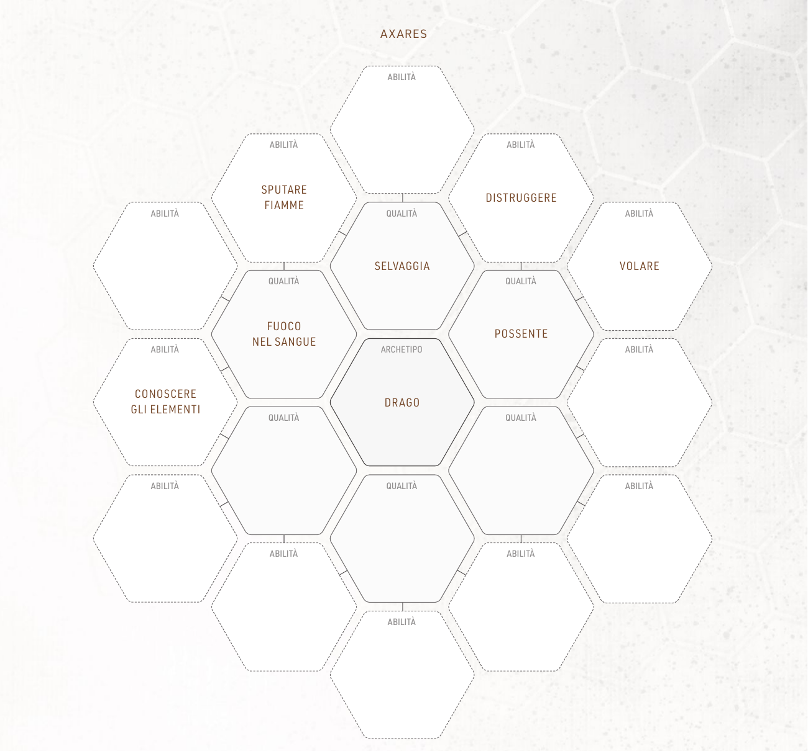
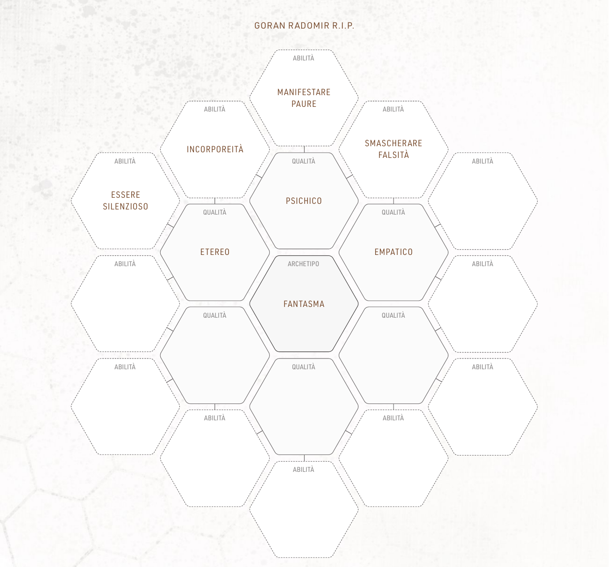
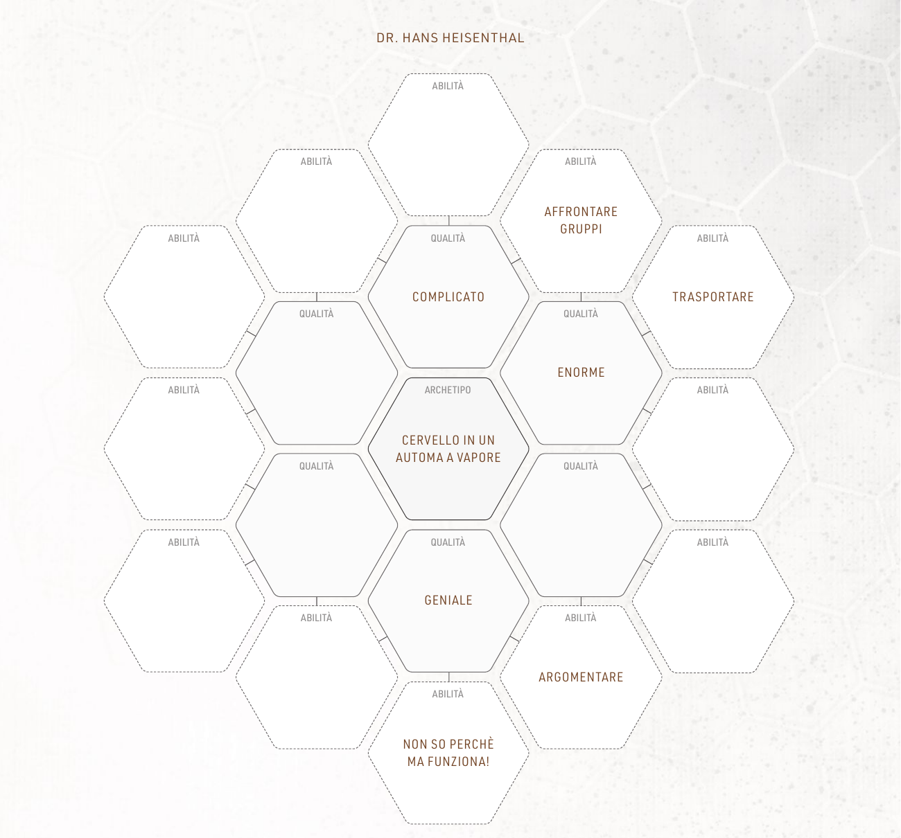

# Die Koeniger Akademie

Il gruppo di Daniele ama il fantasy, ma è stufo delle solite ambientazioni: tutti vogliono qualcosa di più strano del solito gruppo di guerrieri, maghi e ladri. La tradizionale collocazione tra il medievale e il rinascimentale del fantasy viene bocciata all'unanimità e i giocatori iniziano a proporre diverse epoche storiche da riempire di magia. Sono tutti fan del setting "scuola di magia" di Harry Potter, e un paio di giocatori insistono sul voler provare a giocare eroi non umani, se possibile addirittura mostruosi.

Durante la definizione dell'ambientazione Daniele e il suo gruppo immaginano una versione del secondo Reich, l'Impero Germanico all'alba della Prima Guerra Mondiale, che dà la caccia alle creature mostruose e strappa alle famiglie i ragazzini che mostrano di avere la stregoneria nel sangue.

Queste creature sovrannaturali vengono portate in un campo militare, indottrinate e sottoposte a un regime durissimo finalizzato a renderle vere e proprie armi da utilizzare nelle guerre di conquista del Secondo Reich. Questo disegno è probabilmente ordine di un Otto von Bismarck immortale.

Per i coscritti della Koeniger Kriegsakademie la vita quotidiana è fatta di brutale addestramento e disprezzo, e starà agli eroi cambiare questa situazione! La storia di Daniele sarà un fantasy storico, ambientato nel 1911 in una valle segreta fuori Monaco.

## Ogni mitologia è unica

Daniele propone che ogni eroe di questa storia sia depositario di un potere unico e sia l'ultimo esponente di una razza leggendaria o qualcosa di altrettanto raro. Le ispirazioni possono venire dalle differenti mitologie europee e non: l'Impero Germanico può aver rapito un folletto durante una sortita dall'Irlanda, oppure uno spirito-ragno discendente da Anansi dalle colonie africane. Ogni creatura del folklore, come il golem di Praga, vampiri balcanici o licantropi sono bene accetti.

Emanuele vuole esplorare un altro filone di narrativa: propone che a fianco di esseri magici trovino spazio creature nate dall'orrore gotico e la scienza pulp che ispirò la letteratura tra l'Ottocento e il Novecento. Fa l'esempio del mostro del dottor Frankenstein o dei marziani di Barsoom del ciclo di John Carter.

Daniele è d'accordo, ma con così tanta carne al fuoco è importante decidere prima di cominciare a giocare a quali versioni dei miti o racconti i giocatori si rifanno nel definire la loro creatura fantastica.

> **Esempio:** Gianni desidera giocare un fantasma. Spiega che il suo eroe è uno spettro etereo e intangibile, che appare come un riflesso evanescente del ragazzo che era in vita; delle capacità tradizionalmente associate ai fantasmi, è in grado di manifestare le paure di chi lo affronta. Gianni e Daniele concordano che Incorporeità e Manifestare paure debbano essere dei tratti sull'alveare dell'eroe.
>
> Contrariamente ad altri spettri della fiction, l'eroe non è capace di possedere i corpi altrui, almeno per adesso: Gianni non esclude di poterlo aggiungere come tratto in futuro.
>
> Daniele e Gianni chiariscono anche le tradizionali debolezze dei fantasmi: non poter interagire con oggetti solidi se non a grande sforzo, l'essere indissolubilmente legati al luogo o all'avvenimento che li ha uccisi.
>
> A Gianni non servirà segnare nulla sulla scheda a riguardo di queste debolezze, ma il narratore sicuramente le userà per determinare le difficoltà delle prove, o come ispirazione per sventure e complicazioni.

## Un impero minaccioso

L'ambientazione vivrà del contrasto tra le mitologie europee e una tecnologia retrofuturistica all'interno dell'Impero Germanico. Serena propone che la Koeniger Kriegsakademie sia un edificio ispirato agli spettacolari castelli di Ludovico II (come Neuschwanstein), ricoperto di un reticolo elettrico per tenere imprigionati i "cadetti", nome usato per identificare gli esseri reclutati dall'Impero. Zeppelin carichi di bombe sorvolano di tanto in tanto il cielo mentre sulle torri sono presenti postazioni con mitragliatrici e mortai.

Emanuele vuole che dietro l'Accademia ci sia Otto von Bismarck, ritiratosi a vita privata e reso immortale da un misto di magia e tecnologia frankensteiniana, che continua a macchinare per la maggior gloria del Reich. I suoi fedeli sergenti istruttori sono equipaggiati con le peggiori nefandezze che occultisti e scienziati pazzi possano inventare per soggiogare e punire i ribelli. Per i cadetti, la vita quotidiana è un ripetersi di duro addestramento, abuso e indottrinamento.

## Gli eroi guidano la storia

La storia si basa sui canoni della narrativa Young Adult: Daniele non prepara alcun tema centrale, nessuna missione al di fuori del contesto opprimente. Saranno le motivazioni e le decisioni degli eroi a mettere in moto la storia, non un obiettivo proposto loro da qualche personaggio secondario.

Daniele chiede se qualcuno ha una buona idea iniziale per un eroe, qualcuno che possa guidare la ribellione dei cadetti. Serena ha sempre desiderato giocare un drago e non perde tempo a proporsi. Dice che il suo eroe desidera fuggire dall'Accademia per liberare suo padre, il dragone Belenos, soggiogato dal Kaiser e usato come arma di distruzione di massa.

Gianni dice invece che il suo fantasma è bloccato nel castello finché non verrà risolta la faida con il sergente Konrad, che ha ordinato l'eccidio della sua famiglia nei Balcani e che ora è uno degli aguzzini dei cadetti. Saranno queste motivazioni personali a guidare le azioni degli eroi, inizialmente nell'Accademia, poi in lungo e in largo nei territori dell'Impero.

## Suggerimenti di tratti, risorse e nomi

Ogni archetipo è bene accetto: da complessi automi steampunk a mostri portati in patria dalle colonie dell'Impero. Gli stereotipi Young Adult sono tratti che possono dare profondità, parlando del vostro ruolo nell'Accademia.

**Archetipi:** Drago, Vampiro, Fantasma, Cervello in un automa a vapore, Nipote di Thor, Erede di Nostradamus, Nano forgiatore, Esploratore marziano, Golem, Principe mummificato.

**Qualità:** Fuoco nelle vene, Psichico, Iniziato ai misteri, Costrutto, Enorme, Etereo, Geniale, Nobile, Non-morto, Mutaforma.

**Abilità:** Telepatia, Sputare fiamme, Comprendere il nemico, Distruggere, Linguaggi segreti, Alchimia, Maledire, Incidere rune, Spiare, Levitare.

**Tratti alternativi:** Il grimorio del nonno, La corona di argento, Le genti di Nidavellir, È mio di diritto, Scienza folle!, Non funziona così!, Ultimo della mia specie.

Oggetti anche magici sono diffusi per tutta l'Accademia. Alcuni eroi potrebbero proprio dipendere da essi. Ricordate che se un oggetto è centrale per il vostro eroe è bene che diventi un tratto nel suo alveare.

**Risorse comuni:** Razioni alimentari, Boccale di birra, Semplice reagente alchemico, Divisa da cadetto, Munizioni per Mauser C96, La chiave di uno sgabuzzino, Una candela eterna, Tanica di gasolio, Un anello di rame, Carta, penna e inchiostro.

**Risorse rare:** Grappolo di granate a manico, Fulmine in bottiglia, Un rubino puro, Armatura cerimoniale del Duca di Svevia, Lasciapassare K09, Motociclo, Proiettili d'argento, Un pizzico di polvere fatata, Credenza da farmacista, Incantesimo di lettura mentale.

**Risorse eccezionali:** Una fiala di sangue di un dio norreno, La pietra filosofale, Il codice dello studio di Otto von Bismarck, Un bombardiere Staaken R.VI, Il cervello sotto spirito dell'architetto dell'Accademia.

**Nomi tipici:** Helmut Heirsch, Konrad Muller, Fritz Grohl, Lucas Heichmann, Denis Zimmermann, Johann von Berenberg, Mathilde Ludendorff, Hanna Gossler, Heinz Pernet, Wilhelm, la Torre del Grifone, il campo di Herr Graaf, Campo Marsfelt, il villaggio di Furstburg.

## Bulli e dittatori

Le sfide sono alimentate dalla stessa collezione di miti, folklore e narrativa che alimenta la creazione degli eroi. All'interno della Kriegsakademie ci sono principalmente tre tipi di sfide: contro cadetti di differenti vedute, contro istruttori o altri membri dell'Impero Germanico, e infine contro la tecnomagia che permea la struttura dell'Accademia stessa.

Gli altri cadetti cercano di sopravvivere alla situazione, a volte a discapito dei nostri eroi. Come in ogni collegio ci saranno rivali per distinguersi di fronte agli istruttori, o un doppelgänger spione pronto a rovinare piani di fuga. Gli istruttori, per gestire mostri delle specie più disparate, avranno a loro volta qualcosa di speciale, come solide basi di occultismo o proiettili d'argento.

L'Accademia stessa è un edificio in grado di contenere esseri estremamente potenti, ma come? Forse nello studio privato di Bismarck c'è un frammento di anima asportato ad ogni cadetto. Forse la valle in cui sorge l'edificio è allineata con i percorsi di potere sotterranei. Forse ogni singolo cadetto è tenuto imprigionato con un metodo su misura. Esplorate le debolezze delle creature del folklore assieme per trovare ispirazione a riguardo.

### Al di fuori dell'Accademia

A meno di non voler terminare la storia con la fuga del gruppo di eroi, i cadetti si troveranno prima o poi a dover agire al di fuori dell'Accademia, come agenti speciali dell'Impero Germanico o come fuggitivi in cerca di libertà.

I miti sono reali e il mondo si è sviluppato di conseguenza: i grandi imperi coloniali sono riusciti a integrare un pizzico di magia nella rivoluzione industriale. Gli eserciti del Kaiser Guglielmo II sono già affiancati da versioni adulte e più potenti dei cadetti, forse addirittura loro famigliari.

L'impero Russo, quello Britannico e quello Ottomano stanno istituendo a loro volta delle accademie di piccoli mostri pronti a battersi sui campi di battaglia. Chi non lo fa è destinato a essere schiacciato dal Reich.

### Sfide di esempio

**Accumulatore argalvanico.** Uno degli apparati che alimentano la barriera tecnomagica attorno all'Accademia. Un enorme armadio di ottone e acciaio inciso di antiche rune, il cui pannello frontale è coperto di valvole e da cui si diramano cavi.

- *Difficoltà e pericolo delle prove:* le prove riguardanti l'accumulatore sono medie (3 token di complicazione) e abbastanza pericolose (esci di scena estraendo 3 token di complicazione); riprogrammarlo è difficilissimo (5 token di complicazione); durante un temporale qualsiasi prova nelle vicinanze dell'accumulatore aumenta il pericolo di un grado.
- *Possibili sventure:* Accecato dalle scintille, Fulminato, Stordito.
- *Possibili complicazioni:* Nel cuore dell'accumulatore si nasconde uno spirito del fulmine terrorizzato; Due genieri arrivano per manutenzione ordinaria; Uno sbalzo di tensione rompe un apparato vicino; Un parametro errato porterà, nel momento meno opportuno, al blackout di una zona dell'Accademia.
- *Approfondimenti:* gli accumulatori sparsi per l'intera Accademia sono in grado di fornire energia per i più svariati scopi. I circuiti e sistemi di controllo interni sono complicati, ma fragili, e durante i temporali tendono a sovraccaricarsi. Farli esplodere in queste condizioni di sovraccarico causa sempre un successo (1 token di successo) aggiuntivo che va ad amplificare l'effetto della prova.

**Wolfgang, bulletto licantropo.** Alto, muscoloso e dallo sguardo feroce, Wolfgang era già un promettente soldato dell'Impero prima di cadere sotto la maledizione della luna piena. Trasferito alla Koeniger è subito diventato il preferito degli istruttori per la sua forza, disciplina e rispetto della gerarchia. Nulla lo rende più felice che dominare sui nuovi arrivati.

- *Difficoltà e pericolo delle prove:* le prove contro Wolfgang sono medie (3 token di complicazione) e non hanno pericolo; nascondersi mentre ti cerca è difficilissimo (5 token di complicazione) per via dei suoi sensi da predatore; affrontarlo fisicamente diventa difficilissimo (5 token di complicazione) e poco pericoloso (esci di scena estraendo 4 token di complicazione) quando è in forma di lupo; affrontarlo di fronte agli istruttori alza il pericolo di un grado in quanto farà di tutto per metterti in cattiva luce.
- *Possibili sventure:* Umiliato di fronte ai compagni, Pestato nel cortile, Dilaniato da un morso, Intimorito.
- *Possibili complicazioni:* Wolfgang farà la spia con il sergente istruttore; Due leccapiedi di Wolfgang arrivano a dargli manforte; Colpisci per sbaglio un cadetto innocente.
- *Approfondimenti:* non tutti i coscritti dell'Accademia vogliono ribellarsi. Wolfgang incarna lo spirito dell'arma e guida una banda di cadetti invasati che desiderano far carriera. Sventure legate alla paura si applicano sempre contro Wolfgang, anche se si è spaventati da qualcos'altro: sente l'odore della paura e si accanisce contro chi è nervoso.

**Sergente istruttore Einsmann.** Il responsabile della disciplina militare all'interno dell'Accademia. Occhi grigi e fisico secco, tiene l'ordine con totale insensibilità alla sofferenza. Alla cintura tiene marchingegni tecnomagici in grado di mettere in riga anche il più testardo dei cadetti.

- *Difficoltà e pericolo delle prove:* le prove contro Einsmann sono difficili (4 token di complicazione) e poco pericolose (esci di scena estraendo 4 token di complicazione); fargli perdere le staffe o provocarlo è quasi impossibile (6 token di complicazione); mettere in dubbio la sua autorità è molto pericoloso (esci di scena estraendo 2 token di complicazione).
- *Possibili sventure:* In punizione, Fustigato, Sotto stretta sorveglianza.
- *Possibili complicazioni:* Einsmann fa il vostro nome al quartier generale (per una punizione esemplare, per un trasferimento, per promuoverti a ruolo operativo nell'esercito...); Einsmann punisce un vostro compagno innocente; Einsmann vi affida un compito gravoso che vi terrà impegnati.
- *Approfondimenti:* tra i più odiati dai cadetti, sembra che l'umanità di Einsmann sia stata chirurgicamente asportata. Non usa la sferza con sadismo, ma con fredda efficienza. Se un eroe riesce a fare emergere in lui un'emozione qualsiasi (sia positiva che negativa), qualcosa in lui si rompe, il suo volto diventa una maschera di rabbia e sofferenza e agisce inarrestabile guidato solo da follia vendicativa. Tutte le prove seguenti contro Einsmann diventano molto difficili (5 token di complicazione) e molto pericolose (esci di scena estraendo 2 token di complicazione). Pochi giorni dopo aver eliminato Einsmann in questo modo, all'Accademia apparirà il Sergente Zweismann, neo-promosso Istruttore, che sembra aver perso ogni sembianza di umanità.

## Esplora le mitologie

Ogni mostro e creatura letteraria è composta da un misto di poteri unici, debolezze su misura, e una spinta istintiva e primordiale. Scegli quali poteri tradizionalmente legati a una creatura come te possiedi realmente e quali invece sono solo leggenda.

L'Impero ha sicuramente un ruolo in mente per qualcuno con capacità sovrumane come quelle del tuo eroe: forse è un ruolo che potresti accettare di svolgere, forse va contro ogni tuo credo.

Immagina i modi in cui l'Impero potrebbe sfruttare le debolezze del tuo eroe per costringerlo nell'Accademia, e cosa il tuo eroe potrebbe fare per sbarazzarsi dei vincoli che gli sono stati imposti.

Il tuo desiderio primordiale, come quello di sangue per un vampiro, deve essere tenuto a bada. Forse il tuo eroe si sta emancipando da questo istinto, o forse cerca di soddisfarlo in ogni modo pur in questa situazione di simil-prigionia.

Situazioni quotidiane che si possono presentare in qualsiasi collegio si colorano di mistero e ribellione. Una visita degli alti ufficiali, per passare in rivista i cadetti e selezionare chi è pronto per servire nell'esercito, si rivela un'ottima occasione per scoprire qualcuno dei segreti del Reich e per avere informazioni sul mondo esterno. Dimostrarsi abbastanza pronti e disciplinati per un'esercitazione sul campo creerà l'occasione per una fuga, o per eliminare un istruttore particolarmente crudele.

Gli eroi qui proposti rappresentano dei tipici cadetti alla Kriegsakademie, e sono anche un classico trio di amici in una serie Young Adult: un leader impetuoso, un compagno più cerebrale e uno più sensibile.

### Eroi di esempio

Il manuale presenta questi tre eroi come diagrammi ad alveare di esagoni (il formato di scheda standard dell'eroe); qui sono riportati come elenco di archetipo, qualità e abilità, con l'immagine originale del diagramma a corredo di ciascuno.

**Axares** — Archetipo: Drago. Qualità: Selvaggia, Fuoco nel sangue, Possente. Abilità: Sputare fiamme, Distruggere, Volare, Conoscere gli elementi.

**Goran Radomir R.I.P.** — Archetipo: Fantasma. Qualità: Psichico, Eterea, Empatico. Abilità: Manifestare paure, Smascherare falsità, Incorporeità, Essere silenzioso.

**Dr. Hans Heisenthal** — Archetipo: Cervello in un automa a vapore. Qualità: Complicato, Enorme, Geniale. Abilità: Affrontare gruppi, Trasportare, Argomentare, Non so perché ma funziona!.

