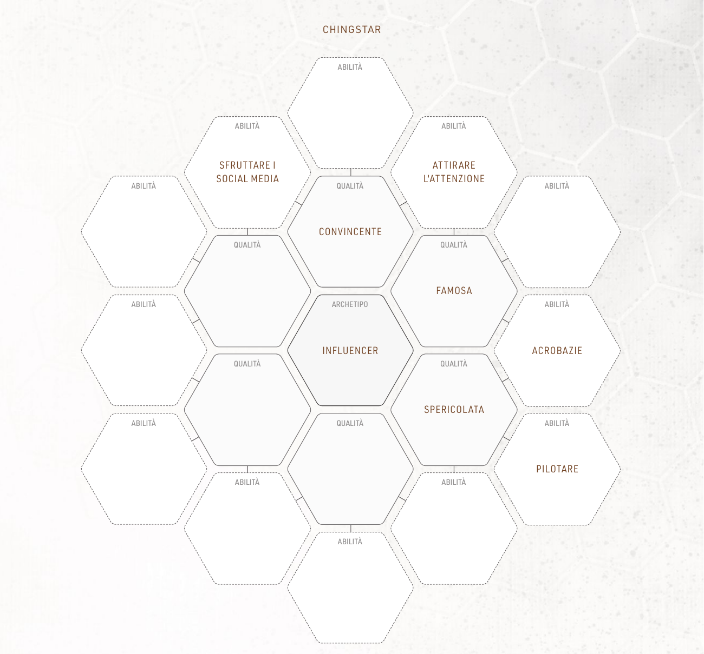
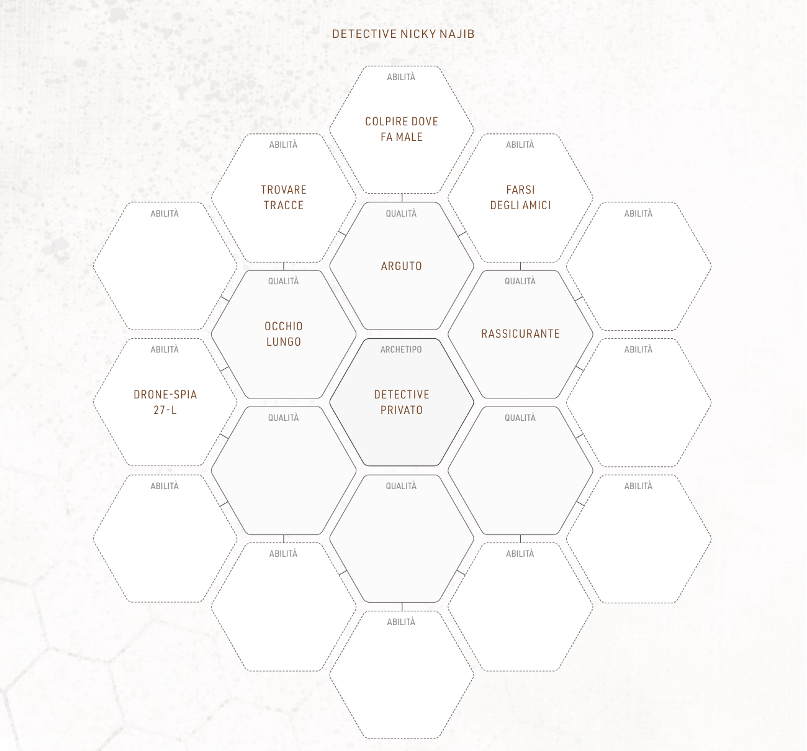
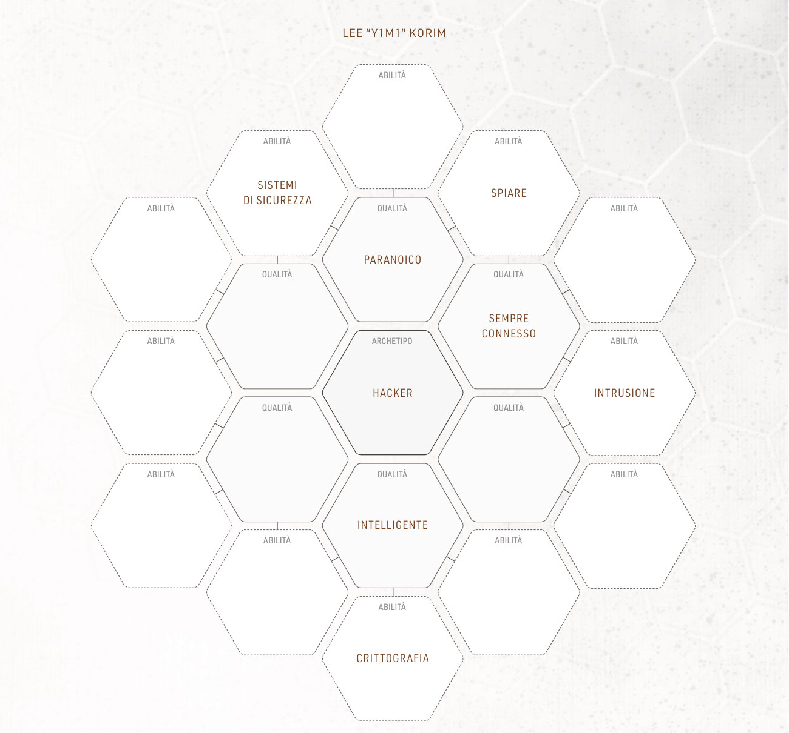

# Sinkapore

Fabio ha chiesto al suo gruppo che genere di storia vuole giocare e riceve diversi suggerimenti con una linea comune: "post-apocalittico", "cyberpunk", "futuro distopico". Fabio decide di ambientare la sua storia nel mondo reale, in un futuro abbastanza prossimo in cui le cose sono andate per il peggio.

Basandosi su una serie di illustrazioni trovate in rete, Fabio decide che il cardine di questo futuro sarà un qualche evento catastrofico che ha accelerato il riscaldamento globale e fatto innalzare i mari a dismisura. Ha questa idea di palazzi che emergono dalle acque e tutto il gruppo è concorde nel voler mantenere l'avventura limitata ad una singola, grande metropoli. Fabio e i suoi amici scelgono una tra le varie città costiere piene di tecnologia e grattacieli.

La scelta ricade su Singapore, già oggi una città-stato estremamente cosmopolita e quindi molto adatta a essere un'ambientazione varia, ma autocontenuta, senza dover definire come la città interagisca con uno stato più grande. Tra i temi tipici della distopia il gruppo sceglie di focalizzarsi sull'onnipresenza della rete e delle corporazioni, che hanno fagocitato le funzioni dello stato.

Scelgono invece di evitare temi come "la rivolta delle macchine": le intelligenze artificiali saranno presenti, ma non così diffuse da rappresentare una fazione della società. La storia sarà quindi ambientata nella Singapore del 2092, che sta lentamente venendo inghiottita dall'innalzamento del mare, in mezzo a una società alla deriva nella tecnologia e nel consumismo.

## Una società a strati

Il gruppo è unanime nel concordare che è la città a essere il vero protagonista di questa storia. Immaginano che i grattacieli che caratterizzano la metropoli abbiano continuato ad aumentare in altezza e in quantità, per far fronte alla crescente domanda del bene più prezioso nell'affollatissima isola-stato: lo spazio.

Eleonora è stata a Singapore per lavoro e le pare logico che l'economia fiorente e un forte orientamento al progresso abbiano reso la città sempre più centrale nei giochi di potere, facendone esplodere la popolazione ben oltre i livelli di comfort.

Purtroppo le misure anti-allagamento prese in seguito al riscaldamento globale hanno fallito: ora i palazzi sorgono direttamente dal Mar di Giava, le fondamenta e i primi piani sommersi dalle acque inquinate. Man mano che si sale i piani si fanno sempre più lussuosi, terminando con giardini verticali, uffici e attici brillanti di neon.

Alessandro propone l'idea che i grattacieli siano collegati tra di loro dalla linea del treno sospeso e anche dalle più disparate strutture. Inventa il Platinum Bridge progettato da Ido Tekashi e Eleonora rilancia dicendo che nei quartieri poveri ci sono passerelle provvisorie tirate con corde. Sotto, nel dedalo di canali salmastri pieni di rifiuti ai piedi degli edifici che Fabio ha rinominato "il Brodo", si muovono chiatte e moto d'acqua. Questo è il regno di reietti e criminali, che vivono alla giornata sapendo che tutti i loro beni potrebbero finire sommersi al prossimo monsone.

Per aumentare il contrasto tra i livelli Alessandro dice che chi può permetterselo invece sfreccia per aria con una hoverbike. Eleonora fa notare il clima tropicale e il gruppo concorda che stare all'aperto significa essere esposti a un caldo umido e appiccicoso, peggiorato dalle migliaia di condizionatori che sputano aria bollente nel già soffocante cielo di Singapore; inoltre, tra una tempesta tropicale e l'altra, si alzano in volo flotte di droni di consegna che muovono l'economia locale.

Mentre il governo si sgretola quanto le fondamenta dei palazzi più vecchi e l'economia mondiale è in crisi di fronte al clima impazzito, la gente della rinominata Sinkapore persevera nei soffocanti micro-appartamenti condivisi con una popolazione incontrollabile di insetti, immersi nella nebbia di smog e minacciati dalle acque che crescono.

## L'evoluzione della tecnologia

Anche se i palazzi crollano, Fabio insiste che l'infrastruttura telecomunicativa dovrebbe resistere. Chiunque si può permettere uno smart-eye, un piccolo device da applicare alla tempia che permette di proiettare il web direttamente sulla retina, e accedere alla miriade di servizi on line. La consegna rapida di beni di consumo è garantita e l'élite che vive ai piani alti pubblicizza il proprio stile di vita dispendioso. Suggerisce anche impianti di protesi bioniche che variano in qualità e diffusione: da un arto meccanico con sensibilità limitata a capolavori di chirurgia ottica per vista notturna assistita o capacità di focalizzazione estrema.

Il gruppo discute brevemente la questione delle intelligenze artificiali. Alla fine Fabio decide che sono comunque sviluppate e molti dei servizi globali sono gestiti almeno in parte da sofisticati algoritmi, ma la tanto temuta singolarità tecnologica, in cui l'intera umanità si trova incapace di comprendere il progresso, incombe minacciosa all'orizzonte da svariati anni senza mai avverarsi. Qualcuno ci spera ancora: di sicuro le macchine non possono peggiorare il mondo più di quanto abbiano già fatto gli umani.

## Il dominio delle corporazioni

A Sinkapore tutto è privatizzato. I giocatori fanno a turno nell'inventare corporazioni e agenzie che pitturano il mondo:

- **Dragonfly Express:** primaria azienda di beni di consumo, i suoi droni da consegna sono onnipresenti nel cielo, tanto quanto gli insetti tropicali.
- **K.E.N.G. Korps, Justice Inc., A.P.P.S.:** per decenni Singapore ha avuto una tradizione di polizia efficiente e tolleranza zero verso crimini anche minori. Ora le compagnie di sicurezza privata prendono in appalto i palazzi e fanno a gara a chi compie più arresti.
- **The building divers (abbreviato in B-Vers o Beavers):** le fondamenta sommerse hanno costante bisogno di riparazione: i beavers indossano tecno-mute d'avanguardia e si tuffano nel Brodo per effettuare riparazioni o per sabotare edifici su commissione. Alcuni ricevono interventi di chirurgia adattiva per stare sott'acqua.

## Suggerimenti di tratti, risorse e nomi

Gli archetipi più comuni sono le professioni diffuse in un futuro distopico, ma non sono fuori luogo concetti più cyberpunk e futuristici.

**Archetipi:** Hacker, Contrabbandiere, Pilota di Hoverbike, Tecno-marine, Androide da compagnia, Maestro di Muay Thai, Chirurgo, Ingegnere, B-ver, Squalo della finanza.

**Qualità:** Intuitivo, Smanettone, Imprevedibile, Fulmineo, Uomo di mondo, Distaccato, Figlio di papà, Empatico, Letale, Bio-ingegnerizzato.

**Abilità:** Assemblare, Immersioni, Sabotare, Assassinare, Armi di precisione, Convincere, Esplosivi, Droghe, Parkour, Strutture aziendali.

**Tratti alternativi:** Coscienza dissolta nella rete, Synthomuscoli potenziati, Occhi bioelettronici FocusPlus X5, Più freddo di un robot, Meglio le macchine che gli uomini, I clienti di Mama Lee, Gli infami della K.E.N.G. Korps, Anarchia!, Disumano.

Certi aspetti della tecnologia sono molto cresciuti, altri meno. Protesi e modificazioni biomeccaniche possono essere risorse o tratti a seconda dell'importanza che ricoprono per te.

**Risorse comuni:** Beni di consumo recapitabili via drone, Hoverbike di seconda mano, Smart-eye, Cibo sintetico, Pistola registrata, Una dose di droga tagliata (male), Una molotov, Arto meccanico, Documento falso, Passaggio su chiatta a motore.

**Risorse rare:** Fucile da cecchino non registrato, Chirurgia subdermale d'avanguardia, Inviti al party dell'anno, Un chilo di stimolante Exta-6 purissimo, Un appartamento spazioso, Teslamborghini HT2 "Firestorm", Smoking in fibra di kevlar firmato da Sabatini, Milioni di followers, Drone da spionaggio, Foto compromettenti di un pezzo grosso.

**Risorse eccezionali:** Il virus "Oblivion" che ti cancella dalla rete, Una testata nucleare, Il cuore di una A.I., L'algoritmo di volo della Dragonfly Express, L'atto di proprietà di un grattacielo.

**Nomi tipici:** Tarini Ninjabi, Jackie Zheng, Darren Tehko, Nor Hafiz, Gabriel Quan, dott. Ming-Jo Zhi, Kelly Pahat, Dominic Tan Jun, Mei Peterson, Kevin Kapoor, "Strawb3rry", "Log4n", "BrightGuy".

## Una città ostile

Sinkapore è una città senza beni a sufficienza per tutti, cane mangia cane in una continua lotta per restare a galla. La polizia privata è corrotta o semplicemente intransigente, trattano il furto di una mela con la stessa serietà di un atto terroristico. Sono dotati di strumenti di sorveglianza e armi pesanti.

Organizzazioni criminali e corporazioni spietate sono spesso indistinguibili le une dalle altre per mezzi e obiettivi, dalle gang del Brodo che difendono il loro angolo di spaccio o ricettazione di beni, ai dirigenti che guardano solo al profitto e sono pronti a distruggere la competizione con ogni mezzo necessario. Negli affari, il fine giustifica sempre i mezzi.

Organizzazioni terroristiche piazzano bombe o vendono segreti senza badare alle conseguenze, per il puro gusto di ribaltare lo status quo. L'idea di rivoluzione etica si è persa completamente, lasciando spazio alla mera ribellione per il gusto stesso della rivolta.

In tutto ciò, la città stessa è ostile. Il clima tropicale porta monsoni, venti e temporali, causando blackout, difficoltà di movimento all'aperto e distruzione di proprietà. L'architettura traballante continua a crescere verso l'alto, unica direzione rimasta, ma le fondamenta marciscono e la città è sempre più simile a un castello di carte in procinto di crollare.

Grossi insetti prosperano nel clima umido e sporco dei bassifondi, e le uniche zone che ne sono prive hanno livelli di inquinamento e tossicità eccessivi anche per gli scarafaggi. Le acque in cui i palombari devono a volte immergersi per operazioni di riparazione o recupero hanno altissimi livelli di inquinamento e radioattività.

A Sinkapore le minacce sono ovunque, così come le opportunità che questo contesto selvaggio e apparentemente privo di regole riserva ai suoi abitanti.

### Sfide di esempio

**Pattuglia dei K.E.N.G. Korps.** Membri della principale forza di sicurezza privata, i Korps si distinguono per l'uniforme antisommossa blu scuro e per il loro addestramento leggermente sopra la media. Armati con manganelli, taser e armi da fuoco, hanno diritto assoluto di arrestare o espellere con la forza chiunque causi disordine nel quartiere su cui hanno giurisdizione.

- *Difficoltà e pericolo delle prove:* le prove contro una normale pattuglia di quattro agenti sono medie (3 token di complicazione) e poco pericolose (esci di scena estraendo 4 token di complicazione); se la pattuglia ti considera un elemento di disturbo si accanisce su di te e le prove diventano difficili (4 token di complicazione) e abbastanza pericolose (esci di scena estraendo 3 token di complicazione); intimidirli è sempre difficilissimo (5 token di complicazione), se in difficoltà si ritirano compostamente; corromperli è facile (2 token di complicazione), ma sono molto esigenti.
- *Possibili sventure:* Proiettile nella spalla, Manganellato, Ricercato dai Korps.
- *Possibili complicazioni:* Un luogo legato al gruppo viene messo sotto sorveglianza; Un ufficiale chiede bustarelle sempre più alte per chiudere un occhio; I Korps vi sequestrano armi, droghe o altro.
- *Approfondimenti:* per i Korps non importa se sei un terrorista o un passante nel posto sbagliato al momento sbagliato: se causi disordine nel loro quartiere ti sbattono fuori a manganellate, o peggio. Hanno un database di sospettati e accesso a una rete di telecamere molto estesa. Iniziare una faida con i Korps è poco saggio: per casi importanti schierano mezzi corazzati e armi pesanti, che alzano notevolmente difficoltà e pericolo delle prove contro di loro.

**Il vecchio aeroporto.** Un tempo lussuoso e trafficatissimo, quando le piste di decollo sono state sommerse l'aeroporto ai bordi della città è stato abbandonato. Dalle acque oleose emerge la sommità di una gigantesca cupola di vetro, crepata e semidistrutta dal crollo della torre di controllo.

- *Difficoltà e pericolo delle prove:* le prove nel vecchio aeroporto sono difficili (4 token di complicazione) e abbastanza pericolose (esci di scena estraendo 3 token di complicazione); le strutture lasciate a sè stesse sono facili (2 token di complicazione) da distruggere; mettere in funzione un aereo o un macchinario sommerso è quasi impossibile (6 token di complicazione).
- *Possibili sventure:* Taglio infetto, Perso sotto la cupola, Stordito dai fumi oleosi.
- *Possibili complicazioni:* Un ladro in cerca di parti funzionanti sceglie di rapinarvi; La crepa lungo la cupola si ingrandisce con un "crack!"; Le murene hanno fatto il nido attorno alla risorsa che cercate.
- *Approfondimenti:* la splendida cupola di vetro, il giardino interno, la cascata artificiale... tutti questi simboli di lusso ora contribuiscono a un ambiente da incubo, fatto di vetri rotti, acque inquinate e animali mutati. Nonostante ciò, è un ottimo luogo per stare lontani dalle forze dell'ordine e recuperare qualche pezzo di motore.

**Archivio "JADE" di Ms. Zhi.** Questo archivio contiene prove incriminanti per molte delle figure importanti della città, raccolte in anni e anni di giornalismo investigativo. È protetto dal miglior firewall e contromisure di cyberspionaggio in circolazione. Cercare di carpire i suoi segreti significa rischiare di rivelargli i propri.

- *Difficoltà e pericolo delle prove:* le prove che riguardano il JADE sono difficilissime (5 token di complicazione) ma non hanno pericolo; distruggerlo è impossibile, ha troppi backup in giro per il mondo; con le giuste informazioni su come aggirare il firewall la difficoltà scende a media (3 token di complicazione), ma Ms. Zhi semina anche tanti indizi-trappola che rendono le prove contro l'archivio abbastanza pericolose (esci di scena estraendo 3 token di complicazione).
- *Possibili sventure:* Bannato dal sistema, Tracciato, Sistemi compromessi, Identità esposta.
- *Possibili complicazioni:* Scopri che JADE contiene informazioni sul vostro conto, e non potete cancellarle; JADE vi fornisce un'informazione errata, di proposito; JADE segnala la vostra intrusione agli agenti di sicurezza.
- *Approfondimenti:* Ms. Zhi, figura leggendaria a metà tra la giornalista d'assalto e la ricettatrice di informazioni, ha passato l'intera vita a costruire una fortuna in segreti e favori. JADE è il nome che il sottobosco dà sia al suo database di peccati della città, che al sistema che lo protegge: un sistema programmato per attaccare chi lo attacca e rubare i segreti di chi cerca di carpire i suoi.

## Non solo eroi

In una situazione distopica come quella di Sinkapore è difficile dire chi è realmente un eroe e chi no. Una gang criminale con pochi, saldi principi morali, ma che per il resto è disposta a qualsiasi lavoro sporco è un'ottima idea per un gruppo, così come una start-up che cerchi di farsi spazio nella corruzione delle mega-corporazioni.

Le società di polizia privata sono più spesso parte del problema che della soluzione. In una situazione così instabile e priva di assoluti è molto facile che il gruppo non resti unito e che gli eroi inizino a farsi la guerra perché ognuno crede in qualcosa di differente.

In questo tipo di ambientazioni è particolarmente importante decidere se si vuole costruire un gruppo con un obiettivo comune o se, viceversa, tutti sono d'accordo nel creare eroi senza restrizioni e vedere dove va la storia.

Eroi che si mettono i bastoni fra le ruote portano a situazioni molto distruttive, ma gli esiti negativi in Not the End sono solo un altro modo per divertirsi: forse è giusto che chi vive in un mondo distopico evolva segnato da più cicatrici e fallimenti del solito.

## Oltre l'umano?

Le intelligenze artificiali sono così diffuse da essere potenziali eroi loro stesse. Per creare un androide, o in generale una I.A. limitata a un singolo corpo sintetico, decidete se ha dei blocchi comportamentali dovuti alla sua programmazione. Decidete se è asservita a un umano, magari un altro eroe, o se è completamente libera.

È possibile creare eroi che vivono come assistenti digitali nel computer da polso di un altro eroe, o come coscienze dissolte in una rete di computer. Oltre a scegliere i tratti, definite i limiti di libertà di queste entità e che ruolo hanno nella società.

Un'intelligenza digitale che può abitare diversi corpi meccanici dovrebbe avere svariati tratti a riguardo. Più avanzato sarà il controllo che ha sui corpi, più tratti il giocatore vorrà dedicare alle azioni compiute tramite la macchina che sta abitando in quel momento.

### Eroi di esempio

Il manuale presenta questi tre eroi come diagrammi ad alveare di esagoni (il formato di scheda standard dell'eroe); qui sono riportati come elenco di archetipo, qualità e abilità, con l'immagine originale del diagramma a corredo di ciascuno.

**Chingstar** — Archetipo: Influencer. Qualità: Convincente, Famosa, Spericolata. Abilità: Sfruttare i social media, Attirare l'attenzione, Acrobazie, Pilotare.

**Detective Nicky Najib** — Archetipo: Detective privato. Qualità: Arguto, Occhio lungo, Rassicurante. Abilità: Colpire dove fa male, Trovare tracce, Farsi degli amici, Drone-spia 27-L.

**Lee "Y1M1" Korim** — Archetipo: Hacker. Qualità: Paranoico, Sempre connesso, Intelligente. Abilità: Sistemi di sicurezza, Spiare, Intrusione, Crittografia.

