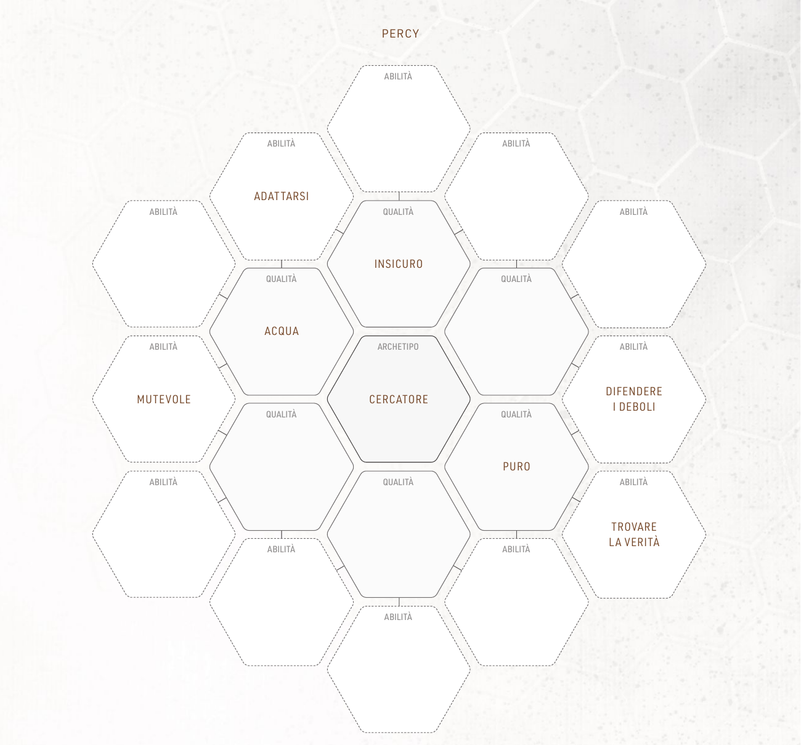
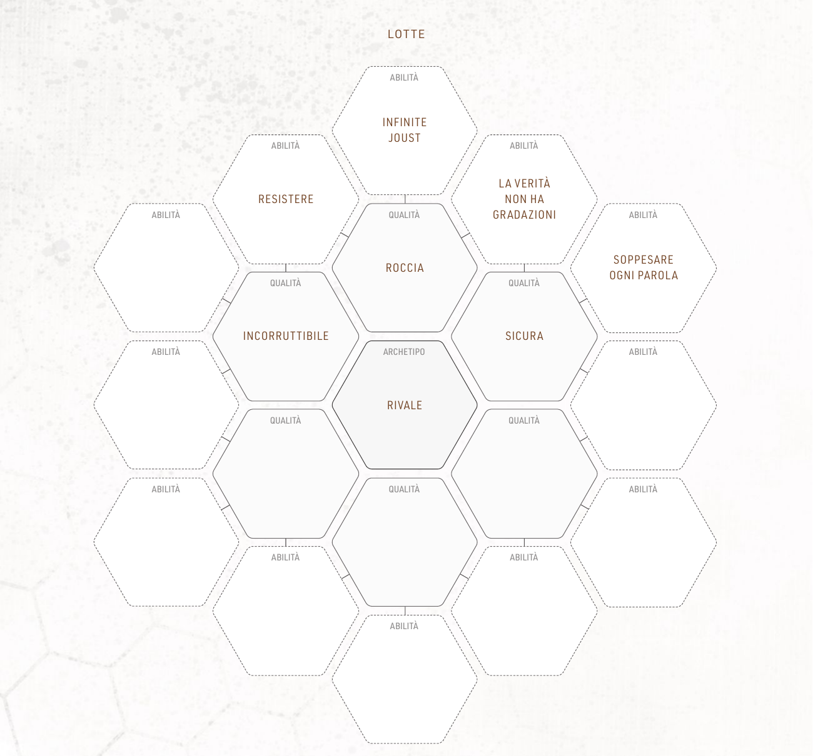
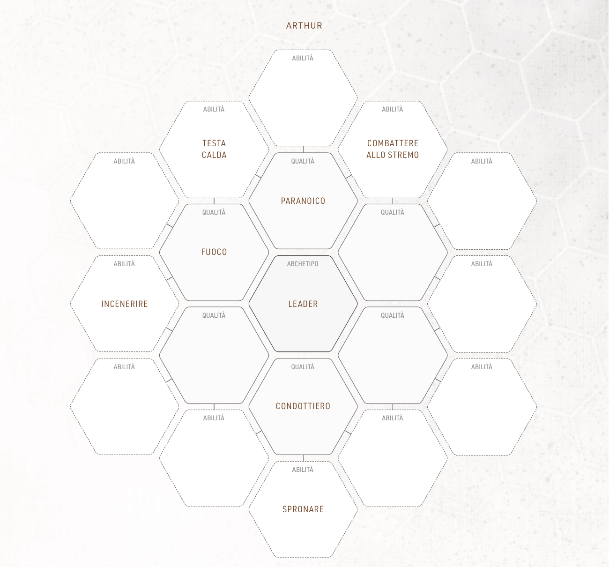

# Knights of the Round

Al tavolo tutti sanno che Claudio è un grande appassionato di anime giapponesi e in particolare di quelli di robottoni. Lui, per convincerli a giocare qualcosa che accontenti sia la propria passione per i mecha che la loro voglia di un classico fantasy, mette sul tavolo Knights of the Round: un'ambientazione che rivisita in chiave super-robot le leggende Arturiane.

Claudio si immagina un lontano pianeta chiamato Brit'an che dopo anni di lotte intestine si trova finalmente unito sotto la guida di Re Pendragon III, che ora governa l'intero pianeta dalla base volante Kamel'oth.

A difendere Brit'an dagli attacchi del crudele Mor Dread, figlio illegittimo di Re Pendragon III, sono i Cavalieri del Round: piloti di armature meccaniche in grado di viaggiare addirittura nello spazio chiamate Knight, alimentate dalle energie del Respiro del Drago, che il Dr. Merlin è riuscito a imbrigliare dopo anni di studio nei laboratori del Round.

L'idea del gruppo è quella di prendere tutti i personaggi, i luoghi e le situazioni del ciclo di leggende arturiane e reinterpretarle in qualche modo: i cavalieri della Tavola Rotonda diventano robottoni, Graal e Excalibur diventano oggetti tecnomeccanici o armi gigantesche e la magia si fonde con la scienza.

## Mecha e magia

La particolarità di Knights of the Round sta proprio nei Knights, potentissime armi in grado allo stesso tempo di salvare Brit'an o di distruggerlo se guidate da uomini privi di onore.

Ogni eroe è un pilota di Knight: robot alchemici unici, dotati di abilità particolari, che rispecchiano le inclinazioni del proprio pilota grazie alla mistica energia del Respiro del Drago che li alimenta e che permette ai piloti di entrare in perfetta sintonia con il proprio Knight, fino al punto da diventare gli uni estensione degli altri.

Matteo e Roberto chiedono a Claudio di non spiegare troppo nel dettaglio quale sia la fonte del cosiddetto Respiro, per poterlo scoprire durante le loro avventure, ma decidono anche che, essendo alimentati dalla magia, i Knight potrebbero essere legati ciascuno a un diverso elemento naturale, che rispecchi il carattere del proprio eroe.

Anche Kamel'oth, la base volante di Re Pendragon, è sicuramente alimentata dall'energia del Respiro, e Matteo pensa che sarebbe interessante se fosse in grado di assorbire il Respiro solo da luoghi specifici, costringendo il castello volante ad atterrare di tanto in tanto per fare rifornimento.

Alice aggiunge un ultimo dettaglio, e cioè che il Dr. Merlin, l'uomo che ha fondato il Round e creato i Knight dopo anni di studio del Respiro, il più grande esperto di studi mistici e alchemici di Brit'an, ha origini avvolte nel mistero, e qualcuno dice che lui stesso sia legato al Respiro come lo sono i Knight.

### Scienza e magia

Anche senza entrare nel dettaglio di cosa sia il Respiro e di quale ne sia l'origine, diventa chiaro a tutti che scienza e magia sono due facce della stessa medaglia.

Il Round è un laboratorio scientifico, con ricercatori divisi in diversi dipartimenti, hangar di costruzione e riparazione per i Knight e livelli sotterranei segreti in cui vengono condotti esperimenti sul Respiro, sui viaggi stellari verso Avalon e dove il gruppo di cavalieri potrebbe scoprire più di quanto vorrebbe.

### Cavalleria, armi magiche e lavoro di squadra

Alice decide di creare Percy, pilota del Knight Parzival, sempre disposto a guardare oltre le apparenze per trovare la verità e calmo in ogni contesto. A volte insicuro, ma in grado di adattarsi a ogni situazione come l'acqua in un vaso. Proprio per rispecchiare questa affinità di Percy con l'acqua, il Knight Parzival è in grado di modificare il proprio aspetto e può combattere senza problemi anche sott'acqua. La sua arma segreta è il cannone Holy Grail.

Matteo prepara invece la scheda di Lotte, la pilota del Knight Lancer. A differenza di Percy, Lotte vede il mondo senza gradazioni di grigio e soppesa ogni sua parola per far valere il proprio punto di vista. Lotte è una guerriera incorruttibile, solida e resistente come una roccia. Il Knight Lancer è allo stesso modo un mezzo corazzato imbattibile, in grado di sopportare anche i colpi più duri. La lancia che impugna si chiama Infinite Joust.

Roberto infine sceglie Arthur, pilota del Knight Excali Burn e figlio di Re Pendragon III. Arthur è il leader dei cavalieri e li guida in battaglia con passione e coraggio, anche se spesso cede all'arroganza e all'ira. La sua capacità di spronare i soldati a combattere allo stremo delle forze è ciò che ha permesso a Re Pendragon III di dare una fine alle guerre civili di Brit'an. Il Knight Excali Burn è un'arma dotata di una potenza incredibile, in grado di incenerire interi eserciti, e proprio per questo estremamente pericolosa se usata da un pilota che ha perso la strada dell'onore. La spada di fiamme dell'Excali Burn si chiama Burning Cutter.

### Tre piloti, un cuore solo

Nella migliore tradizione degli anime giapponesi anni '90, gli eroi sono una squadra composta da membri molto diversi tra loro, a volte in competizione, ma in grado di trovare terreno comune quando si tratta di affrontare una minaccia. Alice, Matteo e Roberto pensano a un breve codice cavalleresco a cui i piloti di Knight aderiscono:

- Difendi chi non è in grado di difendersi dai soprusi
- Sii onesto con i tuoi compagni e credi in loro
- Un cavaliere è forte solo quanto lo è il suo legame con gli altri

## Luoghi importanti

Per rendere meglio l'idea dell'ambientazione, Claudio pensa a tre luoghi che i giocatori potrebbero trovare interessanti da visitare, o il cui nome potrebbe essere sulla bocca di molti dei personaggi secondari che incontreranno.

**Tintagel.** Il luogo in cui è stato costruito il castello volante di Kamel'oth, dove il Respiro del Drago è particolarmente concentrato. Proprio per questo motivo il Dr. Merlin ne ha fatto uno dei principali centri di studio sulle radiazioni del Respiro. Re Pendragon III custodisce gelosamente questa conoscenza tra le mura del castello di Tintagel, dove una squadra speciale di Knight è pronta a respingere ogni visitatore non voluto.

**Avalon.** Avalon è il pianeta più vicino a Brit'an e alcuni dicono che la linea di sangue dei Pendragon provenga proprio da quel pianeta. Chi ci è stato parla di Avalon come di una terra promessa, ricca di risorse, ma la Nebbia di Nimue, una nebulosa che cela la vera posizione del pianeta, rende estremamente pericoloso il viaggio tra Brit'an e Avalon persino ai piloti dei Knight.

**Cam Lann.** Mor Dread ha fatto di Cam Lann la propria base, sperando forse che la superstizione impedisca a Re Pendragon III e al suo esercito di attaccarlo. Si dice infatti che la linea di sangue dei Pendragon troverà la propria fine a Cam Lann, o almeno così riporta la Profezia di Uther, primo dei Pendragon ad aver messo piede su Brit'an 300 anni fa e scomparso poco dopo aver inciso queste parole nelle segrete del castello di Tintagel.

**Stone's Edge.** Stone's Edge è un luogo di cui il Dr. Merlin non vuole parlare, e ogni volta che qualcuno cerca di farlo sbottonare trova una scusa con cui abbandonare la conversazione. Stone's Edge è un circolo di pietre in qualche modo legato ad Avalon e al Respiro, ma l'elevato livello di radiazioni del posto rende quasi impossibile avvicinarsi per esplorarlo.

## Personaggi secondari

Oltre ai personaggi che fanno evidentemente parte della storia, come Re Pendragon III, il Dr. Merlin o Mor Dread, Kamel'oth e Brit'an sono ricche di personaggi secondari con cui gli eroi possono interagire. Claudio decide quindi di prendere alcuni personaggi classici del ciclo arturiano e reinterpretarli con il filtro degli anime di robottoni degli anni '90, che hanno archetipi di personaggi ben chiari.

**Guinevere.** Guinevere è la ragazza di cui sia Arthur che Lotte sono innamorati, ma lei non ha ancora scelto nessuno dei due, e forse non sceglierà mai. Amica di infanzia di Lotte, l'ha seguita al Round quando lei ha deciso di diventare pilota di Knight, e proprio lì ha conosciuto Arthur, di cui ammira il coraggio e disprezza l'arroganza.

**Nimue.** Nimue è una figura misteriosa, dai tratti androgini, che pare abbia un legame diretto con il Respiro e i Knight. Appare solo a chi riesce a manipolare il Respiro e dice di venire da Avalon. Sicuramente conosce il Dr. Merlin e, da alcuni discorsi che i due si sono scambiati, sembra che sia stata lei a rivelargli come incanalare in maniera sicura il Respiro in un Knight.

**Agravain.** Fratello gemello di Arthur, è in continua competizione con lui pur non essendo in grado di pilotare un Knight. Le malelingue dicono che sia una spia di Mor Dread e che stia cercando di sabotare il Round.

**Gallad.** Giovane orfano vittima della guerra a cui Re Pendragon III ha messo fine. Come molti orfani è stato accolto a Kamel'oth, dove vive in cambio di qualche piccolo lavoretto in giro per il castello e dove si allena sperando un giorno di poter pilotare un Knight.

## Suggerimenti di tratti, risorse e nomi

Prendendo spunto sia dal ciclo di racconti arturiano che dagli anime di robottoni giapponesi, Knights of the Round vuole raccontare le avventure di un gruppo unito da un ideale cavalleresco, ma al cui interno non mancano attriti e tradimenti che possono essere superati grazie alla collaborazione degli eroi, in una cornice fatta di spade magiche, fate, radiazioni magiche e robot componibili.

### Tratti suggeriti

| Archetipi | Qualità | Abilità |
| --- | --- | --- |
| Figlio del Drago | Onorevole | Difendere i deboli |
| Condottiero | Coraggioso | Pilotare |
| Paladino | Magia elementale | Trovare la via |
| Cercatore | Resistente | Incenerire |
| Pilota | Affidabile | Mutaforma |
| Stratega | Competitivo | Sopportare |
| Scienziato | Calmo | Illusioni |
| Stregone | Corazzato | Spronare |
| Fatato | Arrogante | Combattere allo stremo |
| Nobile | Cupo | Soppesare le parole |

### Tratti alternativi

Holy Grail, Infinite Joust, Burning Cutter, Linea di sangue, Traditore, Respiro del Drago, Armi ad attivazione vocale, Uniamoci!

### Risorse suggerite

In un mondo tecno fantasy qualsiasi cosa è pressoché giustificabile, ma gli oggetti tecno-magici saranno sicuramente più rari degli oggetti che immaginiamo in un tipico mondo medievale. Ricordate che se un oggetto è centrale per il vostro eroe è bene che diventi un tratto nel suo alveare.

| Comuni | Rare | Eccezionali |
| --- | --- | --- |
| Spade | Sensori per le radiazioni del Respiro | Knight |
| Armature | Sfere di cristallo | Castello volante |
| Cavalcature | Catalizzatori magici | Scaglie di Drago |
| Corde | Comunicatori | Sangue di Drago |
| Cristalli di luce | Anello con sigillo reale | |
| Bacchette | Lance alchemiche | |
| Attrezzi per riparare | | |
| Erbe curative | | |

### Nomi tipici

Anna, Bors, Elaine, Gareth, Hector, Hisolde, Lionel, Morgause.

Per i Knight: Armorak, Belveder, Burner, Key, Leo the Grand, Tris Tran, Uriel.

## La minaccia viene dall'interno

Nell'immaginare Brit'an, Claudio ha pensato a Mor Dread, il figlio illegittimo di Re Pendragon III che vuole rivendicare il trono di Kamel'oth per sé, mettendo in pericolo la pace raggiunta così a fatica dai Brit'anniani.

A seguirlo in questo folle piano di conquista ci sono i suoi tre generali: Morrigan, allieva del Dr. Merlin in grado di manipolare il Respiro con la sola volontà, Calogrenant, pilota del Black Knight, prototipo dei Knight rubato proprio grazie all'aiuto di Morrigan, e Vortigern, abile stratega che ha più volte in passato cercato di distruggere il regno dei Pendragon.

Agli avversari umani si aggiungono poi le bestie leggendarie del canone arturiano, tra cui draghi, driadi in grado di usare il Respiro per ridurre Kamel'oth in cenere e titani di pietra che assomigliano in maniera inquietante ai Knight.

Lotte tra allievi e maestri, tra padri e figli, fanno quindi da sfondo alle avventure degli eroi, ma non sono l'unica cosa in grado di distruggere la fragile tregua che tiene uniti i popoli di Brit'an.

## Immaginare le sfide

Gli eroi di Knights of the Round non sono unicamente cavalieri senza macchia e senza paura, anche se sono pronti a sacrificare loro stessi e i propri Knight per il bene di Brit'an.

I loro voti cavallereschi li porteranno sicuramente ad affrontare Mor Dread e i suoi uomini, ma potrebbe essere altrettanto interessante esplorare i segreti del respiro del Drago, della linea di sangue dei Pendragon e del Dr. Merlin!

Una cosa importante da tenere conto in Knights of the Round è che gli eroi non sono i Knight stessi, quindi si troveranno ad affrontare sfide che non possono essere risolte da una cabina di pilotaggio.

### Black Knight

Il Black Knight troneggia sopra agli altri Knight sconfitti, spada e scudo pronti ad abbattere anche il Knight Perzival. Calogrenant sorride dalla cabina di pilotaggio dell'oscuro Knight, sicuro di aver messo in scacco i Knight di Kamel'oth. Che il suo acume tattico supremo abbia avuto la meglio sul coraggio dei cavalieri?

**Difficoltà e pericolo delle prove**
- Affrontare il Black Knight è difficilissimo (5 token di complicazione) e molto pericoloso (esci di scena estraendo 2 token di complicazione)
- Calogrenant è un ottimo combattente anche fuori dal Black Knight, affrontarlo è comunque difficile (4 token di complicazione) e pericoloso (esci di scena estraendo 3 token di complicazione)
- Affrontarlo dopo avergli fatto perdere le staffe o dopo averlo superato in astuzia diventa in ogni caso facile (2 token di complicazione)

**Possibili sventure**
- Posizione svantaggiosa
- Knight in avaria
- Senso di inferiorità

**Possibili complicazioni**
- Il Black Knight rivela la sua arma segreta, Dark Grievance. Se sei a bordo di un Knight o se usi il Respiro, diventa estremamente pericoloso (esci di scena estraendo 1 token di complicazione)
- Un gruppo di soldati dell'esercito di Mor Dread pronto a tendere un'imboscata!
- Calogrenant si calma: lo scontro torna a essere difficile (4 token di complicazione)

**Approfondimenti**

Calogrenant è stato il primo pilota di un Knight. Il prototipo realizzato per lui dal Dr. Merlin doveva essere solo un esempio di come il Respiro del Drago potesse essere usato per alimentare i Knight. Quando il Black Knight venne equipaggiato con la Dark Grievance, Calogrenant propose a Re Pendragon II di usarlo per mettere fine in poche ore alla guerra. Ne seguì uno scontro tra Calogrenant e Re Pendragon II, che si concluse con la morte del sovrano e il furto del Black Knight, ancora instabile, da parte di Calogrenant.

### La foresta di Bertilak

La foresta di Bertilak si estende nel profondo delle Midlands di Brit'an per ettari ed ettari, inviolata e spaventosa. Nessun uomo osa avvicinarsi alla foresta e nemmeno i più coraggiosi o folli penserebbero di esplorarla senza il benestare dei druidi che vi abitano e che custodiscono gelosamente i propri segreti.

**Difficoltà e pericolo delle prove**
- Attraversare la foresta è mediamente difficile (3 token di complicazione) e per niente pericoloso, ma farlo dopo averla danneggiata diventa difficile (4 token di complicazione) e poco pericoloso (esci di scena estraendo 4 token di complicazione)
- Usare il Respiro del Drago è facilissimo (1 token di complicazione), ma molto pericoloso (esci di scena estraendo con 2 token di complicazione), perché si trova quasi allo stato puro
- Tutte le prove, se effettuate a bordo di un Knight, aumentano di 1 token di complicazione la difficoltà

**Possibili sventure**
- Perso
- Infettato dalle spore
- Nemico dei druidi

**Possibili complicazioni**
- I druidi vi scagliano contro il Green Knight, una copia arborea di un Knight animato dalla foresta stessa!
- La nebbia inizia ad alzarsi, orientarsi nella foresta diventa difficile (4 token di complicazione)

**Approfondimenti**

I druidi della foresta di Bertilak vogliono tenere lontani gli intrusi per non dissacrare le rovine che si trovano nel cuore della foresta. Cosa si trovi nelle rovine lo si può solo supporre, perché nessuno di coloro che ci è arrivato è mai tornato indietro. Antichi manoscritti dicono che la foresta sia la tana del Drago il cui Respiro viene usato da stregoni e Knight. Il Dr. Merlin potrebbe sapere cosa si trova nel cuore della foresta, così come Morrigan, ma entrambi custodiranno il segreto a costo della vita.

### Morrigan

"Non sono più la tua allieva, Merlin, ora sono molto di più!"

Morrigan ha ormai trasceso la sua forma umana e assomiglia più a uno Sidhe, creature di puro Respiro che abitavano Brit'an prima dell'arrivo degli umani, millenni fa. "Io sono il Respiro ora, la linea dei Pendragon si estinguerà qui e oggi per riportare l'equilibrio a Brit'an!"

**Difficoltà e pericolo delle prove**
- Usare un Knight contro Morrigan è molto difficile (4 token di complicazione) e molto pericoloso (esci di scena estraendo 2 token di complicazione)
- Nutre un particolare odio per la famiglia Pendragon e le prove per tutti coloro che sono legati con il sangue alla famiglia reale aumentano di 1 token di complicazione la difficoltà

**Possibili sventure**
- Allucinazioni
- Marionetta
- Paralizzato

**Possibili complicazioni**
- Morrigan fa rivivere a ognuno di voi un momento in cui la famiglia Pendragon ha tradito le vostre aspettative, per indebolire la vostra volontà
- Essendo diventata puro Respiro, Morrigan non può più essere ferita fisicamente
- Morrigan corrompe il Respiro che alimenta i vostri Knight: usare un Knight contro di lei è quasi impossibile (6 token di complicazione)

**Approfondimenti**

Dopo essere stata abbandonata al Round da suo padre, Morrigan ha studiato il Respiro sotto l'ala del Dr. Merlin, diventando la più autorevole conoscitrice di Knight di tutta Brit'an. Il Dr. Merlin le ha svelato anche conoscenze segrete, di cui nemmeno Re Pendragon III è a conoscenza, nella speranza di trovare un'alleata nella lotta contro Mor Dread. Ritiene ancora Re Pendragon III responsabile della guerra che ha costretto suo padre ad abbandonarla.

## Piloti ed eroi

Gli eroi presentati fino a questo momento sono tutti piloti di Knight, ma il bello di giocare un'ambientazione come questa con Not the End è che anche chi non usa un Knight può partecipare all'azione quanto i piloti di mecha.

Esattamente come in un anime, personaggi importanti potrebbero essere altri membri dell'esercito di Kamel'oth, ma anche ricercatori del Round, druidi che riescono a vedere il valore delle azioni dei Knights of the Round o visitatori di Avalon.

Se volete creare un nuovo pilota di Knight, prendete un cavaliere della Tavola Rotonda dal ciclo arturiano: quello sarà il Knight che il vostro pilota guiderà! Dopo aver trovato il Knight e l'elemento a cui è associato, definite il carattere del vostro eroe in modo da rispecchiare l'elemento: gli eroi legati al fuoco saranno passionali e coraggiosi, ma anche testardi e irruenti, quelli legati alla terra saranno distaccati e coriacei, quelli legati all'acqua pazienti e capaci di adattarsi e così via…

Se invece volete creare un eroe diverso, pensate a quale potrebbe essere il suo ruolo all'interno del Round: un fabbro in grado di riparare i Knight? Un druido che cercherà di guidare i piloti di Knight verso un fantomatico equilibrio? Un esperto di Respiro, in grado di manipolarlo con incantesimi e rituali?

### Schede d'esempio

Il manuale presenta a corredo di questa ambientazione tre schede visuali di eroi (Percy, Lotte, Arthur), con i tratti disposti nell'alveare esagonale secondo le relazioni descritte sopra. Di seguito l'elenco di archetipo, qualità e abilità di ciascuno, con l'immagine originale del diagramma.

**Percy** (pilota del Knight Parzival) — Archetipo: Cercatore. Qualità: Insicuro, Acqua, Puro. Abilità: Adattarsi, Mutevole, Difendere i deboli, Trovare la verità.

**Lotte** (pilota del Knight Lancer) — Archetipo: Rivale. Qualità: Roccia, Incorruttibile, Sicura. Abilità: Infinite Joust, Resistere, La verità non ha gradazioni, Soppesare ogni parola.

**Arthur** (pilota del Knight Excali Burn) — Archetipo: Leader. Qualità: Paranoico, Fuoco, Condottiero. Abilità: Testa calda, Combattere allo stremo, Incenerire, Spronare.

L'esatta disposizione dei tratti nell'alveare, con le relazioni di vicinanza che ne derivano, è visibile solo nella scheda grafica originale del manuale.
