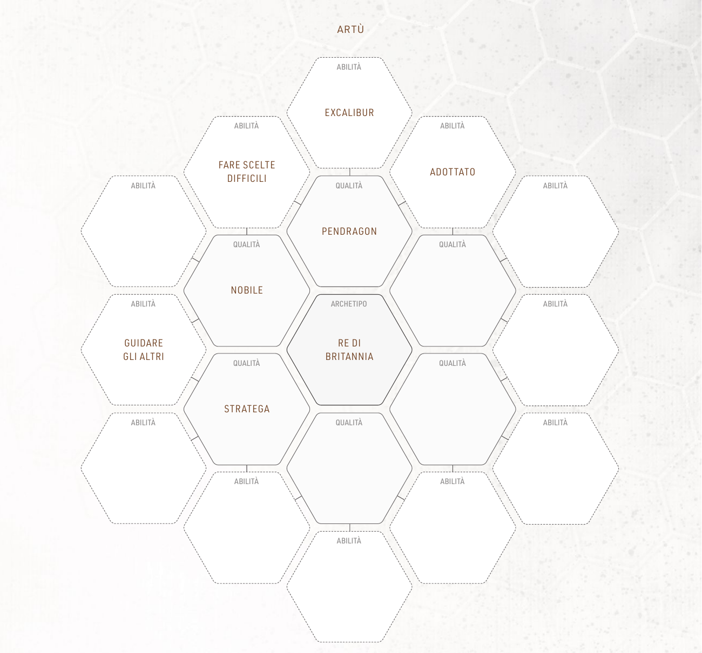
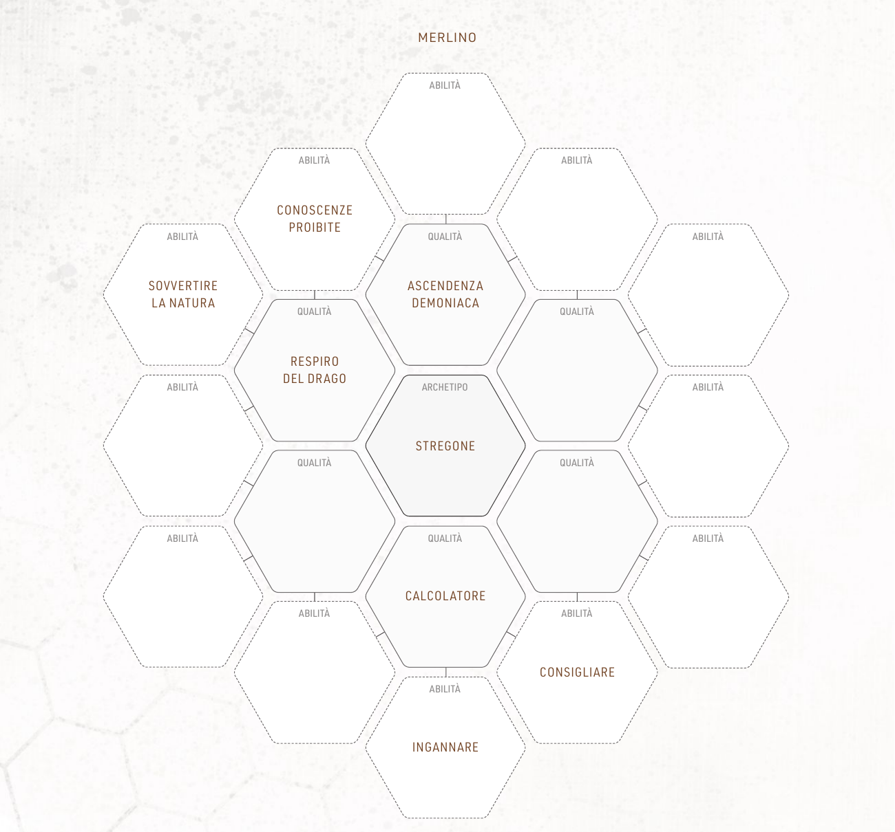
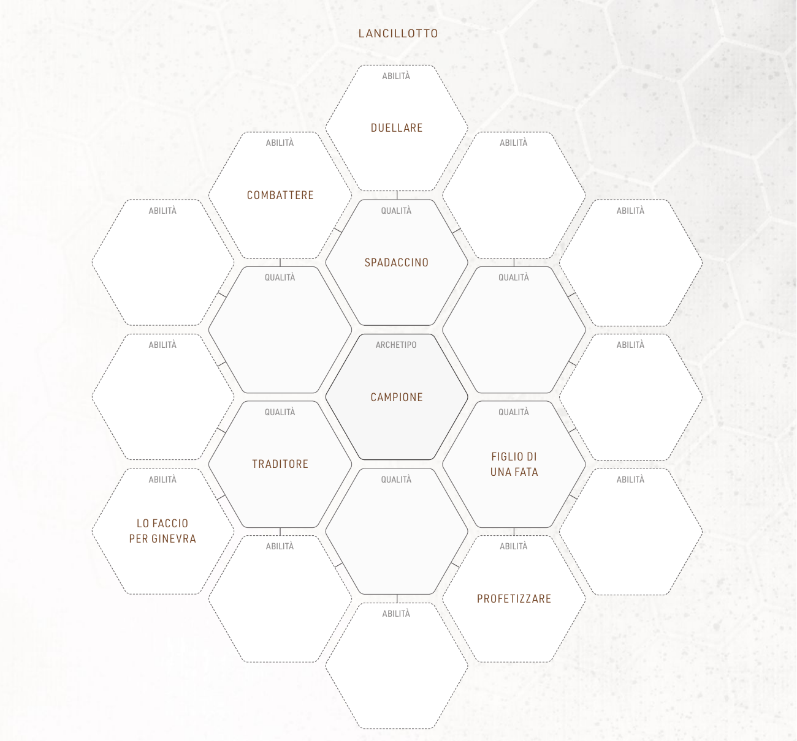

# La tavola rotonda

Non esiste al mondo un fantasy più classico del ciclo arturiano: nobili cavalieri, draghi, spade magiche e tradimenti per amore. Luca ha letto tantissimi libri sulla storia di Re Artù, Excalibur è uno dei suoi film preferiti e chiede al resto del gruppo di provare a giocare i cavalieri della Tavola Rotonda.

Il ciclo arturiano che tutti conosciamo è molto lontano dalla realtà dell'Inghilterra del V secolo e Luca infatti si immagina cavalieri in scintillanti armature complete, che duellano con onore per il proprio re, in una commistione di misticismo e religione che permette di far convivere stregoni come Merlino e Morgana con il Graal.

Quello di Camelot non è un mondo realistico e coerente, ma poetico e fantastico, e ogni eroe potrebbe incarnare un valore cavalleresco, essere incantatori in grado di cambiare forma o ancora essere discendente di un re Inglese che ha giurato fedeltà a Camelot e Artù, ultimo baluardo contro gli invasori del continente.

Luca chiede ai suoi giocatori: "Tra Artù, Ginevra, Merlino, Lancillotto, Tristano, Mordred… di tutti questi personaggi iconici, di chi vi piacerebbe vestire i panni in una storia fatta di giuramenti spezzati e lotte fratricide, di magia e onore?"

## Fantasia d'altri tempi

Il ciclo arturiano, pur essendo uno dei fantasy più classici, è molto lontano da quelle storie che hanno reso famoso il genere ai giorni nostri.

La storia di Camelot per come la conosciamo è più vicina al lavoro di un bardo che di uno storiografo, priva di una linea temporale coerente e ricca di dettagli a volte contraddittori. Ci sono però alcuni punti fissi, e Luca e gli altri decidono di partire da quelli per costruire i propri personaggi e definire la loro Camelot.

Gianni sceglie di interpretare un giovane Artù, che ha da poco estratto Excalibur dalla roccia e che ancora fatica a comprendere i consigli e gli insegnamenti del suo tutore Merlino. Figlio di Uther Pendragon, è diventato re di Britannia e ora si trova a dover raccogliere il proprio esercito per respingere gli invasori Sassoni e fondare l'Impero di Britannia. Il suo destino è di essere tradito per essere poi seppellito ad Avalon.

Federica coglie l'occasione per interpretare Merlino, lo stregone mentore e consigliere di Artù. Il potere magico di Merlino viene dal suo essere figlio di un demone e di una donna, cosa che gli ha permesso di entrare in comunione con il Respiro del Drago, una forza che permea tutto il mondo e che permette a Merlino di sovvertire le leggi della fisica. Merlino è legato a Nimue, la Dama del Lago, ed è un personaggio freddo, calcolatore e disposto a sacrificare i propri amici per i propri obiettivi.

Marco sceglie invece Lancillotto, cresciuto dalla stessa Nimue e al contempo miglior amico di Artù nonché suo traditore. Lancillotto è un cavaliere impareggiabile, coraggioso e astuto, che ha commesso il grave errore di innamorarsi di Ginevra, promessa sposa di Artù. Lancillotto ha giurato di seguire Artù fino alla morte, ma il suo amore per Ginevra è come una spada di Damocle che pende sopra la sua testa, pronto a incrinare il rapporto tra i due compagni al minimo passo falso.

A opporsi ad Artù e ai suoi cavalieri sarà Mordred, cugino di Artù e legittimo erede al trono di Britannia, aiutato da Morgana, sorellastra di Artù e allieva di Merlino. In un mondo vasto come quello della Britannia mitica di Artù i pericoli giungono sempre da chi ti è più vicino, aggiungendo alle rivalità il coinvolgimento personale.

## Stregoni, draghi, cavalieri e spade magiche

Nelle storie del ciclo arturiano la magia è un dato di fatto, così come lo è per noi sapere che la Terra gira intorno al Sole: qualcuno potrebbe non crederci, ma è una realtà che la maggior parte delle persone non si sognerebbe di mettere in discussione. Questo non vuol dire che la magia sia a portata di tutti o che sia ben vista da tutti: la magia è una forza arcaica, con cui solo druidi e stregoni osano immischiarsi sfidando il volere di Dio. Anche se nessuno dei cavalieri oserebbe mai cercare di usare incantesimi e sortilegi, nessuno di loro si è mai opposto all'aiuto di Merlino, né tantomeno si è tirato indietro davanti a oggetti magici:

- Artù porta al suo fianco Excalibur e il suo fodero, che lo protegge dalle ferite mortali
- Lancillotto ha ricevuto in dono da Nimue, la Dama del Lago che l'ha cresciuto, un anello in grado di svelare ogni menzogna e ogni illusione
- Bedivere impugna una lancia in grado di uccidere i draghi
- Parsifal parte alla ricerca del santo Graal, la coppa che ha raccolto il sangue di Cristo e che è in grado di curare qualsiasi male

In un modo o nell'altro tutti i personaggi si ritrovano ad avere un legame con la magia: Gianni segna come tratto per Artù Excalibur, perché è un oggetto così iconico da rappresentare Artù quanto il suo essere un re. In tutti i racconti che parlano di Artù, il re bretone finisce sempre per scegliere la spada rispetto al fodero, cosa che, alla fine, lo condanna a morte durante il suo ultimo scontro con Mordred.

Marco invece decide che l'anello di Lancillotto non è così importante da diventare un tratto e lo segna quindi tra le risorse, ma tra i tratti segna comunque Figlio di una fata, per ricordare a tutto il gruppo di essere stato cresciuto da Nimue.

Federica segna, come archetipo di Merlino, Stregone, e segna la qualità Respiro del Drago, a cui collega anche l'abilità Conoscenze proibite. Tra queste, Federica immagina che ci siano anche conoscenze del mondo fatato e delle antiche creature che abitano il mondo oltre il velo dell'illusione: giganti, folletti, draghi e alberi dotati di volontà costellano i racconti del ciclo arturiano e sono in genere antagonisti che i cavalieri devono battere grazie al loro coraggio o alla loro astuzia.

## Suggerimenti di tratti, risorse e nomi

Pensare ai tratti di un personaggio del ciclo arturiano è facile, basta leggere un riassunto delle leggende del singolo cavaliere che si vuole interpretare e leggere gli epiteti con cui gli autori hanno descritto i personaggi: Lancillotto sarà sicuramente un valoroso cavaliere che finirà per tradire il proprio sire, Galahad veniva chiamato il puro, Parsifal è il cercatore del Graal e ovviamente Merlino è un potente stregone.

### Tratti suggeriti

| Archetipi | Qualità | Abilità |
| --- | --- | --- |
| Re di Britannia | Nobile | Guidare gli altri |
| Stregone | Traditore | Conoscenze proibite |
| Cavaliere | Puro | Ingannare |
| Fata | Coraggioso | Duellare |
| Giullare | Onorevole | Mantenere la parola |
| Cercatore | Spadaccino | Trovare tracce |
| Guardiano | Stratega | Profetizzare |
| Cacciatore di mostri | Onesto | Mutare forma |
| Campione | Valoroso | Resistere alla tentazione |
| Cantastorie | Fedele | Combattere |

### Tratti alternativi

Excalibur, Figlio di una fata, Respiro del Drago, Pendragon, Uno contro cento.

### Risorse suggerite

Il lato fiabesco del ciclo arturiano rende difficile capire quali siano le risorse comuni a Camelot, perché i personaggi fanno tutti parte della corte di re Artù e per loro quello che in altri contesti fantasy dovrebbe essere comprato con centinaia di monete d'oro viene dato per scontato. Alcuni oggetti dotati di proprietà magiche potrebbero essere risorse rare e solo oggetti unici come il Graal o Excalibur dovrebbero essere risorse speciali.

| Comuni | Rare | Eccezionali |
| --- | --- | --- |
| Spada | Sfera di cristallo | Excalibur |
| Armatura | Castello | Anello di Nimue |
| Cavallo da guerra | Pietre fatate | Sangue di drago |
| Scudo | Scacchiera | Graal |
| Lancia | Stendardo reale | Ciocca di una fata |
| | Pegno di una dama | |

### Nomi tipici

Artù, Bedivere, Bors, Ettore, Gaheris, Galahad, Gawain, Ginevra, Isotta, Kay, Lamorak, Lancillotto, Merlino, Mordred, Morgana, Pellinore, Parsifal, Tristano, Uther, Ygraine.

## Mostri ed eserciti

Gli eroi del ciclo arturiano difficilmente restano a Camelot a lungo: la loro è una vita fatta di cerche, che li portano a viaggiare per tutta la Britannia a caccia di mostri, o a combattere contro eserciti invasori, in genere di popolazioni barbare come i sassoni e pagane come i romani.

Queste cerche mettono spesso i cavalieri davanti a ostacoli che possono essere superati solo con astuzia, coraggio e costanza, e i nostri eroi si troveranno spesso anche ad affrontare scelte morali complicate: cosa scegliere tra il guadagno personale e il bene comune, o tra l'orgoglio personale e l'onore cavalleresco?

Creature come il Cavaliere Verde, che disturba la quiete di Camelot proprio durante i festeggiamenti del Natale e che apparentemente non può essere sconfitto, druidi o draghi mutaforma che vogliono che i propri segreti rimangano tali o esseri fatati che chiedono un sacrificio personale di uno o più cavalieri sono all'ordine del giorno.

Le due più grandi minacce alla pace della Britannia sono Mordred e Morgana, che odiano Artù così tanto da essere pronti a radere al suolo Camelot, e qualunque alleato del re, con un esercito bardato di armature nere e reso invincibile dagli incantesimi della strega.

Ogni sfida, a Camelot, è una questione personale per qualcuno, così come nei racconti del ciclo arturiano c'è sempre un cavaliere che si trova al centro di un conflitto che arriva dal suo passato e che è stato profetizzato nel suo futuro.

### Il Cavaliere Verde

Quale dei cavalieri di Camelot è abbastanza coraggioso da raccogliere la mia sfida? Sono disposto a lasciare che uno di voi mi colpisca per decapitarmi, a patto poi io possa fare lo stesso con lui. Accettate il mio duello, o i cavalieri della Tavola Rotonda sono solo dei codardi?

**Difficoltà e pericolo delle prove**
- Accettare e vincere il duello con il Cavaliere Verde è facile (2 token di complicazione), ma molto pericoloso (esci di scena estraendo 2 token di complicazione)
- Uccidere definitivamente il Cavaliere Verde usando la propria forza è impossibile
- Affrontare il Cavaliere Verde in gruppo è disonorevole e aumenta la difficoltà di 1 token di complicazione per ogni persona che partecipa al combattimento

**Possibili sventure**
- Codardo
- Disarmato
- Alle strette

**Possibili complicazioni**
- Il Cavaliere Verde si divide in due in seguito a un colpo e affrontarlo diventa pericolosissimo (esci di scena estraendo 1 token di complicazione)
- Gli eroi riconoscono la magia di Morgana intrisa nella lama dell'ascia del Cavaliere: la strega sta aspettando il momento giusto per colpire Camelot!

**Approfondimenti**

Il Cavaliere Verde è una creatura immortale che abita il castello nei pressi di Green Chapel. Si presenta a Camelot chiedendo di sfidare a duello il cavaliere più valoroso della Tavola Rotonda. Il patto è semplice: il cavaliere di Camelot potrà sferrare il primo colpo, e se il Cavaliere Verde riuscisse a sopravvivere avrà diritto a sferrare un colpo a sua volta. In caso contrario riverserà la propria ira su Camelot e gli abitanti della Britannia. Il Cavaliere è in realtà un alleato di Morgana e di Mordred, mandato a ridicolizzare Artù e intaccare il morale dei suoi soldati.

### La corte di Oberon

Il re delle fate sorride a voi cavalieri, indicando il ricco banchetto che avete davanti a voi. "Venite, la mia mensa è aperta a tutti, il cibo è caldo e il vino è buono!" esclama, ma mentre vi guardate intorno e osservate i commensali che mangiano felici, sentite un brivido corrervi lungo la schiena, come se qualcosa di orribile stesse per accadere.

**Difficoltà e pericolo delle prove**
- Resistere agli ordini di Oberon dopo aver mangiato o bevuto qualsiasi cosa dalla sua mensa è quasi impossibile (6 token di complicazione)
- Percepire ciò che le illusioni di Oberon nascondono è estremamente difficile (5 token di complicazione)
- Ferire Oberon è facilissimo (1 token di complicazione) e pericolosissimo (esci di scena estraendo 1 token di complicazione) a causa degli incantesimi che lo proteggono

**Possibili sventure**
- Ammaliato
- Allucinazioni
- Avvelenato

**Possibili complicazioni**
- Venite separati da un incantesimo: ognuno di voi si trova da solo in una delle stanze del palazzo di Oberon!
- Oberon vi propone un patto: libererà tutte le persone prigioniere della sua corte se un cavaliere si offrirà di prestare giuramento e diventare una delle sue guardie, ripudiando Artù

**Approfondimenti**

Oberon, il re delle fate, è una creatura lasciva e interessata solo a divertirsi alle spalle degli umani. La sua corte, così confortevole e allettante, è solo l'ennesima trappola in cui Oberon si diletta ad attirare i viandanti, offrendo loro un pasto caldo e un letto per dormire. Peccato che chiunque prenda posto alla corte non se ne possa più andare, finendo per dimenticarsi di ciò che c'è fuori dalla corte.

### Mordred e Morgana

L'esercito di Mordred ha ormai circondato tutta Camelot e guardando dalla torre più alta del castello riuscite a vedere Mordred, nella sua armatura dorata, a cavallo in testa al suo esercito. Al suo fianco vedete Morgana, circondata dalla nebbia magica del Respiro del Drago.

**Difficoltà e pericolo delle prove**
- Raggiungere Mordred evitando di essere sopraffatti dall'esercito è difficilissimo (5 token di complicazione) e abbastanza pericoloso (esci di scena estraendo 3 token di complicazione)
- Affrontare Mordred a duello è normale (3 token di complicazione) e molto pericoloso (esci di scena estraendo 2 token di complicazione)
- Affrontare Morgana senza l'aiuto di uno stregone è molto difficile (4 token di complicazione) e molto pericoloso (esci di scena estraendo 2 token di complicazione)

**Possibili sventure**
- Circondato
- Ferito
- Ustionato

**Possibili complicazioni**
- Mordred svela il doppio gioco di uno dei cavalieri della Tavola Rotonda
- Morgana crea un muro di fuoco che vi impedisce di ritirarvi
- Morgana usa il Respiro del Drago per tramutare Mordred in un drago sputafuoco, molto difficile (4 token di complicazione) e molto pericoloso (esci di scena estraendo 2 token di complicazione) da affrontare

**Approfondimenti**

Mordred odia Artù con tutto il suo cuore e brama la vendetta su Camelot più di ogni cosa. Proprio Mordred convince Lancillotto a farsi avanti con Ginevra per poi rivelare il tradimento ad Artù. Sempre Mordred convince Artù a una tregua per cacciare un gigantesco serpente che minaccia la Britannia, solo per rivelare che il serpente non esiste e cercando subito dopo di pugnalare Artù a tradimento. Mordred riesce sempre a fuggire grazie all'aiuto di Morgana, la sorellastra di Artù, che ritiene il re un presagio di sventura per la Britannia.

## Di cavalieri, armi e onori

Nel ciclo arturiano, se si fa eccezione per pochi personaggi, tutti i protagonisti delle leggende sono cavalieri. Anche quelli che a prima vista sembrano semplici popolani si rivelano sempre figli segreti di qualche nobile, discendenti di qualche fata o più semplicemente valorosi combattenti il cui valore permette loro di guadagnare un posto alla Tavola Rotonda.

Questo non significa però che tutti gli eroi che giocherete debbano essere valenti guerrieri votati al codice della cavalleria: Merlino e Morgana sono solo due degli stregoni che animano le storie di Camelot. Ginevra, pur non imbracciando mai le armi, è una figura estremamente importante, che guida e sostiene la gente di Camelot e Artù stesso.

Inoltre ci sono scudieri, re di paesi vicini e lontani che si trovano a passare qualche tempo a Camelot e creature divise tra due mondi come Nimue o altri abitanti di Avalon, Tintagel e boschi limitrofi.

Potrebbe anche essere interessante esplorare la vita nel castello proprio dal punto di vista di quei personaggi che si trovano sempre al margine delle storie dei cavalieri: come si comportano i servi del re quando lui e i suoi cavalieri sono in guerra? Merlino si lascia andare, rinunciando al suo fare impettito e severo, quando l'unica persona nella stanza è un ciabattino? E quali segreti si lasciano scappare i nobili quando pensano di non essere ascoltati?

Ancora più interessante potrebbe essere una partita in cui gli eroi sono quei mostri che i cavalieri hanno giurato di sconfiggere durante le loro cerche: giganti, folletti, draghi mutaforma e fate potrebbero avere tutto l'interesse di vedere Camelot cadere, aiutando Mordred o Morgana invece che Artù.

### Schede d'esempio

Il manuale presenta a corredo di questa ambientazione tre schede visuali di eroi (Artù, Merlino, Lancillotto), con i tratti disposti nell'alveare esagonale secondo le relazioni descritte sopra. Di seguito l'elenco di archetipo, qualità e abilità di ciascuno, con l'immagine originale del diagramma.

**Artù** — Archetipo: Re di Britannia. Qualità: Pendragon, Nobile, Stratega. Abilità: Excalibur, Adottato, Fare scelte difficili, Guidare gli altri.

**Merlino** — Archetipo: Stregone. Qualità: Ascendenza demoniaca, Respiro del Drago, Calcolatore. Abilità: Conoscenze proibite, Sovvertire la natura, Consigliare, Ingannare.

**Lancillotto** — Archetipo: Campione. Qualità: Spadaccino, Traditore, Figlio di una fata. Abilità: Duellare, Combattere, Lo faccio per Ginevra, Profetizzare.

